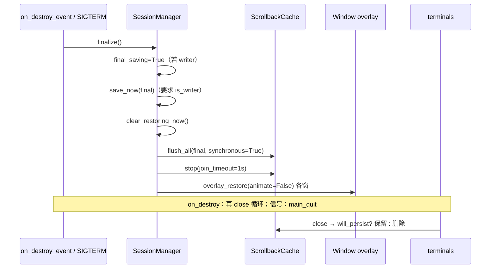
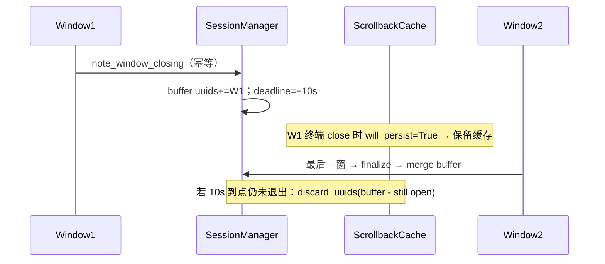
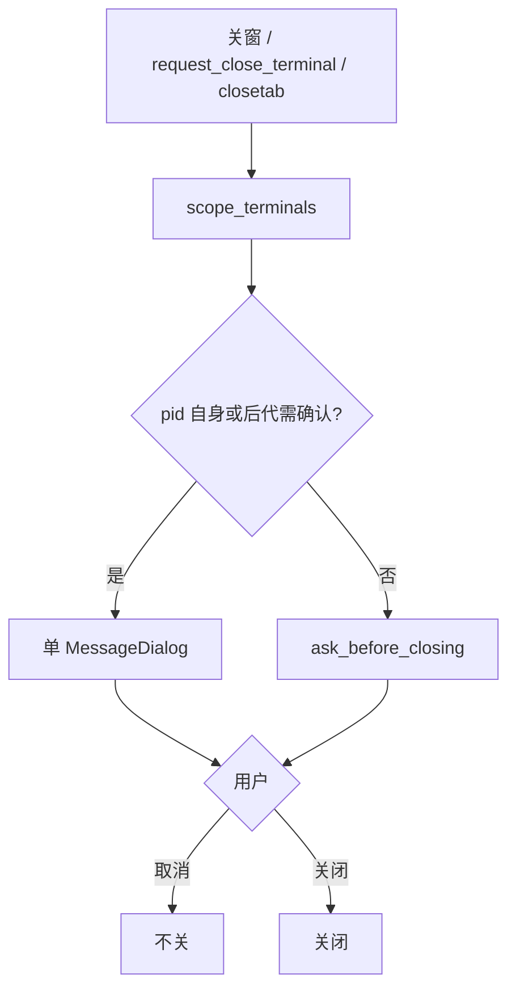

# 子方案 A：会话保存/恢复 + D17 关闭确认

> 总方案：[`../session-restore-design.md`](../session-restore-design.md) §A、§A.8、§1A.5–1A.6、D1/D5/D6/D10/D11/D12/D17。  
> 适用代码：`TIIEHenry/terminator` @ `9f2d0b6`。文中 `file:line` 均基于该提交。  
> **范围**：M1 中的 **A（布局+cwd 实时保存/恢复）** + **D17（关窗/Ctrl+Shift+Q/关终端的进程确认）**。  
> **不包含**：B 采集/回填实现（只定义与 B 的接口契约）、C 标题栏 ✕→D17（M2 调用本模块 API）、D 浮层、E。  
> **约束**：只做设计、不改代码。私人单机：**无 hostname 后缀**；不做隐私强制。  
> **r2（并行审查+父级决议）**：已并入 `docs/reviews/findings-summary.md` 与父级 11 条决定。

---

## 0. 目标与验收

| # | 验收项 | 期望 |
|---|---|---|
| A1 | 无参启动 → 摆布局/cd → 退出再开 | 窗/tab/分屏/ratio/cwd/活动终端一致 |
| A2 | 拖分隔条后 ≤1.5s `kill -9` | 新 ratio 已落盘 |
| A3 | `kill -TERM` / `SIGHUP` | `finalize()` 完成后退出；异常不挡 `main_quit` |
| A4 | 末终端 `exit` | 会话不被空布局覆盖；该 uuid 的滚动缓存**保留**（`will_persist`） |
| A5 | `-l foo` / `-e` / `--working-directory` / 非属主 | **不恢复、不写会话**（`save_now` 即便 `final` 也要求 `is_writer()`） |
| A6 | D5：约 10s 内关多窗 | 布局全部写入；缓冲期内 `will_persist=True`；超时 A 调 `ScrollbackCache.discard_uuids` |
| A7 | 崩溃保护 | `restoring` 残留 → 跳过恢复；**正常退出也清标记** |
| A8 | D17 有相关进程 | **单个** MessageDialog；默认焦点「取消」；取代 `ask_before_closing` |
| A9 | D17 无相关进程 | 仍走 `ask_before_closing` |
| A10 | Ctrl+Shift+W | 走 `request_close_terminal`（修现状无确认） |
| A11 | 幂等 | `on_destroy_event` 重入不二次 `note_window_closing` / 不覆盖 D5 缓冲 |

估计（A+D17+会话页，不含 B）：**6–7.5 人日**（审查上调；含 A2b、D17 忽略名单、旧 zoom 范围）。

---

## 1. 现状代码地图（实现前必读）

### 1.1 启动 / 布局 / 退出

| 步骤 | 位置 | 现状 |
|---|---|---|
| 默认 layout | `optionparse.py:158-159` | 无 `layout_from_default` |
| 主实例 | `terminator:127-137` | `reconfigure` → `create_layout` → `layout_done` |
| 描述 | `terminator.py:638-646` → `container.py:269-335` → `terminal.py:1948-1966` | `save_cwd=True` 才有 directory |
| 销毁 | `window.py:295-311` | **先** `terminal.close()` **再** deregister；无 save |
| 快捷键关窗 | `window.py:221-225` | 直接调 `on_destroy_event`，末尾 `destroy()` 再触发一次（**重入**） |
| 0 终端 | `terminator.py:175-178` | `window.destroy()` → 再进销毁路径 |

### 1.2 cwd

| API | 位置 |
|---|---|
| OSC7 | `terminal.py:257-268` |
| psutil 回退 | `cwd.py:15-20` |
| 恢复 | `terminal.py:1982-1983` / `1690-1692` |

缺口：无 `current-directory-uri-changed` 连接。

### 1.3 关闭确认

| 路径 | 位置 | 确认？ |
|---|---|---|
| 关窗 / Ctrl+Shift+Q | `window.py:282-293` | ✅ `construct_confirm_close` |
| 菜单关终端 | `terminal_popup_menu.py:87-102` | ✅ |
| **快捷键关终端** | `terminal.py:2101-2102` | ❌ |
| Tab ✕ | `notebook.py:375-422` | ✅ |
| UI | `container.py:155-233` | 仅 `ask_before_closing`，**不查进程** |

### 1.4 隐患（本模块必须处理）

1. 旧 zoom：`describe_layout` / `get_terminals` / `on_delete_event` 子树只剩被放大终端 → **日常 dirty 跳过**；final 时先无动画 unzoom（仅 legacy）；D17 范围必须含 `zoom_data['old_child']`。
2. 浮层放大（M3）：**不**跳过保存（占位委托）；`finalize` 里在 save 之后再 `overlay_restore(animate=False)`。
3. 叶子值必须 str；`size` 必须是**逐元素**字符串列表，禁止 `str(tuple)`。
4. 0 终端不写盘。
5. `Paned.ratio`：`new_size`（`paned.py:477-481`）在分配时会更新；标脏挂 **`new_size` 末尾**（兼拖动与程序化 set_position），不必依赖 `button-release`（GTK3 手势可能吞掉）。

---

## 2. 文件与模块边界（决议 #10）

| 文件 | 职责 |
|---|---|
| `terminatorlib/util.py` | `get_state_dir()` / `get_cache_dir()`（仿 `get_config_dir` `util.py:212-221`） |
| `terminatorlib/session.py` | `SessionManager`、路径/锁/崩溃标记、D5 缓冲、`finalize` |
| `terminatorlib/close_confirm.py` | 进程探测、`request_close_terminal`、对话框 |
| `terminatorlib/scrollback.py` | B（本模块只调用其公开 API） |
| `terminatorlib/paneoverlay.py` / `autofont.py` | D / E（他模块） |

常量：

```python
SESSION_LAYOUT_NAME = '__last_session__'
SESSION_VERSION = 1
QUIT_ALL_WINDOW_GRACE_S = 10.0
PERIODIC_MARK_DIRTY_S = 60
RESTORING_CLEAR_DELAY_S = 10
```

路径（**私人单机，无 hostname**）：

| 用途 | 默认 |
|---|---|
| 状态目录 | `$XDG_STATE_HOME/terminator` → `~/.local/state/terminator` |
| 会话 | `{state}/session.json`（`session_file` 非空则用之） |
| 锁 | `{state}/session.lock` |
| 崩溃标记 | `{state}/restoring` |
| 轮转 | `session.json.prev` / `.prev2` / `.bad` / `.crashed` |

---

## 3. `SessionManager(Borg)` API

```python
class SessionManager(Borg):
    _timer = _periodic_timer = _last_change_hash = None
    _lock_fd = None
    _owns_session = False          # D10：无参启动且持锁
    final_saving = False
    restored_this_run = False      # 供 B 回填门闩
    _closing_buffer = None         # D5: {deadline, by_child_name: layout_fragment, uuids: set[str]}
    _write_failures = 0
    _disabled = False
    _loaded_session_uuids = None   # set[str] | None
    _finalize_done = False

    def acquire_lock(self) -> bool: ...
    def set_owner_from_options(self, options) -> None:
        """持锁 + layout_from_default + 无 -e/-x/--working-directory/--config-json
        + 非「仅 --no-restore 且配置关」写路径禁用  → _owns_session=True。
        --no-restore：仍可 acquire_lock（便于写空/清除），但 restored_this_run=False，
        且若用户未要求写则 is_writer 仍可在运行中保存「从现在起」的布局（可选）；
        **决议：--no-restore 只跳过恢复，属主实例运行中仍可写会话。**"""

    def is_writer(self) -> bool:
        return self._owns_session and self._lock_fd is not None and not self._disabled

    def is_owner(self) -> bool:
        """B.start() 用；同 is_writer 的属主语义（不看 _disabled）。"""
        return self._owns_session and self._lock_fd is not None

    def mark_dirty(self, reason: str = '') -> None:
        """忽略：doing_layout / final_saving / not is_writer /
        任一窗 legacy zoom 或 scaled_zoom（is_zoomed and not is_overlay_maximised）。
        浮层放大：不忽略。
        防抖：timer 空则 timeout_add；已有则不重置。"""

    def _flush(self) -> bool: ...

    def save_now(self, final: bool = False) -> bool:
        """**无论 final 与否**，开头：if not self.is_writer(): return False。
        见 §3.1。"""

    def load(self) -> dict | None: ...
    def sanitize_layout(self, layout: dict) -> dict: ...
    def install_signal_handlers(self) -> None: ...

    def note_window_closing(self, window) -> None:
        """D5：在树仍完整时描述该窗片段，按 layout child 名合并进缓冲；
        收集该窗终端 uuid；刷新 10s deadline。超时回调：
        discard = buffer.uuids - uuids_still_open_or_in_final_layout
        ScrollbackCache().discard_uuids(discard)；清空缓冲。"""

    def will_persist(self, terminal) -> bool:
        """「该 uuid 是否会出现在下次将恢复的会话里」——不是 final_saving 时序。
        True 当：
          - final_saving 且 is_writer（整进程退出，会话将含当前 describe）；或
          - uuid 落在 D5 _closing_buffer.uuids；或
          - uuid 属于仍打开窗口且 is_writer（常规运行中 close 某终端 → False）。
        无 uuid 的终端 → False（跳过 B 文件操作）。
        末终端 exit：finalize() 在 close() 之前调用，故 close 时 final_saving 已 True → 保留。"""

    def session_uuids(self) -> set[str] | None:
        """已 load 的会话中 Terminal uuid 集合；无会话/未恢复 → None（B 不删孤儿）。"""

    def finalize(self) -> None:
        """统一退出入口。见 §3.2。"""

    def begin_restore(self) -> None: ...
    def schedule_clear_restoring(self) -> None: ...
    def clear_restoring_now(self) -> None:
        """正常退出 / finalize 时立即删 restoring。"""
    def check_crash_marker(self) -> bool: ...
    def clear_session_files(self) -> None:
        """会话+标记；并 ScrollbackCache().clear_all()。"""

    def state_dir(self) -> str: ...
    def session_path(self) -> str: ...
```

### 3.1 `save_now` 要点

1. `if not self.is_writer(): return False`（**含 final**；修复 D10 / `-l` 覆盖）。
2. `layout = describe_layout(save_cwd=True)`；保存前 ratio 已由运行中 `new_size` 维持，describe 前再刷一次保险。
3. 终端数 0 → 不写。
4. `_stringify_leaves`：`size` 等序列 → `[str(x) for x in seq]`；UUID → `str`；bool → `'True'`/`'False'`；**禁止** `str(tuple)`。
5. D12：去掉 Window 节点 `title`。
6. 变更检测：对 **layout 的 canonical JSON**（或去掉 `saved_at` 后的整包）做 hash，与 `_last_change_hash` 比；`saved_at` **不参与**比较。
7. `final` 时先轮转 `.prev`/`.prev2`，再 atomic write（`mkstemp`+`fchmod 0600`+`fsync`+`replace`+目录 fsync）。
8. 合并 D5 缓冲（按 **layout child 名**，因 Window.uuid 不稳定、且 `describe_layout` 不持久化窗 uuid）。
9. DBus 二次启动 `ipc.new_window_cmdline` 建的窗：若主实例是 writer，运行中 mark_dirty **会**把它们写进会话（属主进程内的窗）；**另起的 `-u -l` 进程**非 writer → 整进程不写。决议 #5「DBus-opened `-l` windows not persisted」含义：**从属客户端进程**不写；主实例内由 DBus 打开的 default 新窗仍随主实例会话保存。若产品要排除「仅本次 DBus 打开的窗」，需窗级标记——**M1 不做**，文档注明。

### 3.2 `finalize()`（决议 #3）

```python
def finalize(self):
    if self._finalize_done:
        return
    self._finalize_done = True
    try:
        if self.is_writer():
            self.final_saving = True
            self.save_now(final=True)
            self.clear_restoring_now()
        # B：即便非 writer，stop 也应安全 no-op
        try:
            from .scrollback import ScrollbackCache
            cache = ScrollbackCache()
            if self.is_writer():
                cache.flush_all(final=True, synchronous=True)
            cache.stop(join_timeout=1.0)
        except Exception as ex:
            dbg('scrollback finalize: %s' % ex)
        # D：保存之后再还原浮层，避免丢掉 maximised_pane
        try:
            for w in list(Terminator().windows):
                if getattr(w, 'is_overlay_maximised', lambda: False)():
                    w.overlay_restore(animate=False)
        except Exception as ex:
            dbg('overlay restore on finalize: %s' % ex)
    finally:
        # 调用方负责 close 循环 + main_quit；信号路径在此 main_quit
        pass
```

**调用约定：**

| 入口 | 行为 |
|---|---|
| `on_destroy_event` 开头（最后一窗） | 幂等守卫 → `finalize()` →（可选 D 已在 finalize 内还原）→ **原有** close 循环 → deregister |
| 非最后一窗 | 幂等 → `note_window_closing` → close 循环（**不** finalize） |
| SIGTERM/SIGHUP | `finalize()` → `Gtk.main_quit()` → `SOURCE_REMOVE`；各步 try |

`on_destroy_event` 幂等：

```python
if getattr(self, '_session_destroy_handled', False) or self.isDestroyed:
    return
self._session_destroy_handled = True
```

### 3.3 与 B 的契约

| API | 语义 |
|---|---|
| `is_owner()` | B.start 门闩；非属主 B 全 no-op |
| `restored_this_run` | 本次从会话恢复成功 |
| `will_persist(terminal)` | 见上；B 在 `close` 时据此保留/删除文件 |
| `session_uuids()` | 孤儿清理；`None` = 不删 |
| `finalize()` | 内调 `flush_all(sync)` + `stop(join 1s)` |
| `ScrollbackCache.discard_uuids(set)` | D5 缓冲**超时**时由 A 调用 |
| `ScrollbackCache.clear_all()` | `--clear-session` / 首选项清除 |
| `ScrollbackCache.feed_notice(term, text)` | 崩溃跳过说明、cwd 回退说明（纯文本 feed）；**远程 ssh 分隔线 M1 不做（CUT）** |

---

## 4. D17 / `close_confirm.py`

### 4.1 进程规则（决议 #2）

```python
SHELL_BASENAMES = {
    'bash','sh','zsh','fish','dash','ksh','csh','tcsh','login',
}
# argv0 去前导 '-' 再比

DEFAULT_CLOSE_CONFIRM_IGNORE = [
    'gitstatusd', 'ssh-agent', 'gpg-agent', 'dbus-daemon',
]
# 配置键 close_confirm_ignore: list(str)，DEFAULTS 元素必须是 str
```

计入「需确认」的进程：

1. **`terminal.pid` 自身**（若 basename 去掉 `-` 后 **不在** `SHELL_BASENAMES`——少见，但覆盖 `-e vim` 这类）；**以及**
2. `children(recursive=True)` 中 basename ∉ `SHELL_BASENAMES` ∪ `close_confirm_ignore` 的进程。

`pid is None`（Flatpak/`spawn_async` 尚未回调）或无 `/proc` / psutil 失败 → **保守弹确认**（文档写明：Flatpak 可能误报）。

### 4.2 `scope_terminals(root)`（决议 #7）

```python
def scope_terminals(root_widget) -> list:
    maker = Factory()
    if maker.isinstance(root_widget, 'Terminal'):
        return [root_widget]
    # Window：不要只 enumerate(get_child())——漏浮层 / 旧 zoom 隐藏树
    if maker.isinstance(root_widget, 'Window') or hasattr(root_widget, 'is_zoomed'):
        window = root_widget.get_toplevel()
        terms = [t for t in Terminator().terminals if t.get_toplevel() is window]
        if window.is_zoomed() and getattr(window, 'zoom_data', None):
            old = window.zoom_data.get('old_child')
            if old is not None:
                # 并入旧树中的终端（可能已不在 get_toplevel 映射里）
                terms = _unique(terms + _terminals_under(old))
        return terms
    # Notebook / Paned / 其它：enumerate_descendants；遇 PanePlaceholder 委托 .terminal
    return _terminals_under(root_widget)
```

`has_multiple_terms(window)`（C/D 共用，可放 window 方法）：`len(scope_terminals(window)) > 1`。

### 4.3 `request_close_terminal` / 对话框

```python
def request_close_terminal(terminal) -> bool:
    """找最近 construct_confirm_close → 确认则 terminal.close()；返回是否关闭。"""

def construct_confirm_close(self, window, child):  # 扩展 container.py:155
    terminals = scope_terminals(child if not maker.isinstance(child,'Window') else child)
    # 若 child 是 Window，直接 scope_terminals(window)
    need, procs = should_confirm_processes(terminals)
    if need:
        return show_process_close_dialog(window, terminals, procs)
        # 单 MessageDialog；取消=默认焦点；无「不再询问」
    return <existing ask_before_closing logic>
```

挂钩：

| 路径 | 改动 |
|---|---|
| `construct_confirm_close` | 进程优先 |
| `on_delete_event` | 对 **Window 自身** 调 `scope_terminals(self)`（不要只传 `get_child()`） |
| `TerminalPopupMenu.close_terminal` | **委托** `request_close_terminal` |
| `key_close_term` | 调 `request_close_terminal(self)` |
| M2 标题栏 ✕ | 同 `request_close_terminal` |

---

## 5. 标脏挂钩点

| 变动 | 位置 | 备注 |
|---|---|---|
| split | `paned.py:37-77` / `window.py:629-672` / `notebook.py:179-232` 末尾 | |
| remove | `paned.py:247` / `notebook.py:239` / `window.py:607` | |
| deregister_terminal | `terminator.py:169` | 0 终端不 save |
| newtab / closetab | `notebook.py:278` / `:375` | |
| switch-page | `notebook.py:38` | handler 末尾 |
| page-reordered | **新连**（`:62` 旁） | 仅 dirty |
| **分隔条 / 尺寸** | `Paned.new_size` `paned.py:477-481` 末尾 | **主路径**；不靠 button-release |
| configure-event | `window.py:122-131` 新连 | 实际 pos/size 变才 dirty |
| window-state | `window.py:338` | |
| cwd | `terminal.py:521` 旁 VTE 信号 | `signal_lookup` 兼容 0.78+ |
| 标题/分组/profile | `1546` / `681`/`666` / `227` | |
| zoom/unzoom | `window.py:690`/`721` | legacy 期间 mark_dirty 内部跳过 |
| **pane-maximise-changed** | Window 新信号（D 定义） | 浮层进入/退出时 dirty（可保存 maximised_pane） |
| layout_done | `terminator.py:359` 后 | `mark_dirty('layout_done')` + `schedule_clear_restoring` |
| 60s 周期 | SessionManager | `mark_dirty('periodic')` |

监听浮层：`Window` 发 `pane-maximise-changed(terminal, active: bool)`（D 实现）；A 连接后 `mark_dirty`。跳过保存**仅** legacy zoom / scaled_zoom。

---

## 6. 启动恢复

`optionparse.py:158-159`：

```python
if options.layout is None:
    options.layout = 'default'
    options.layout_from_default = True
```

CLI：`--no-restore` / `--restore` / `--clear-session`（无短参）。

`terminator:127-133`（`reconfigure` 后、`create_layout` 前）——**A2b 先于 A3**：

```python
sess = SessionManager()
got_lock = sess.acquire_lock()
sess.set_owner_from_options(OPTIONS)
sess.install_signal_handlers()   # 主实例即可；内部检测旧插件
if OPTIONS.clear_session:
    sess.clear_session_files(); # 含 B.clear_all
# 恢复条件
if (config['restore_last_session'] or OPTIONS.restore) and got_lock \
   and getattr(OPTIONS,'layout_from_default',False) \
   and not OPTIONS.command and not OPTIONS.execute \
   and not OPTIONS.working_directory and not OPTIONS.configjson \
   and not OPTIONS.no_restore:
    if sess.check_crash_marker():
        # feed_notice 延后到首个 terminal spawn 后（B.feed_notice）
        pass
    else:
        data = sess.load()
        if data:
            sess.begin_restore()
            layout = sess.sanitize_layout(data['layout'])
            config.base.layouts[SESSION_LAYOUT_NAME] = layout
            sess._loaded_session_uuids = {...}
            OPTIONS.layout = SESSION_LAYOUT_NAME
            sess.restored_this_run = True
```

`list_layouts` / config save / prefs：过滤 `__last_session__`。  
`Terminal.create_layout`：若有 `maximised_pane` → `self._restore_maximised=True`（供 D 在 layout_done 后 idle 无动画放大）。

sanitize：目录不存在 → `~`，并记下供 `feed_notice`；删 `command`；不写 OSC title。

---

## 7. 时序图

### 7.1 finalize（最后一窗 / 信号）



### 7.2 D5 多窗



### 7.3 D17



---

## 8. 配置与 UI

### 8.1 新键

| 键 | 类型 | 默认 | UI |
|---|---|---|---|
| `restore_last_session` | bool | `True` | 会话页 |
| `session_save_delay_ms` | int | `1500` | 仅文件 |
| `session_file` | str | `''` | 仅文件（空 → `session.json`） |
| `close_confirm_ignore` | list(str) | 见上 DEFAULT | 仅文件（M1 不进 UI） |

### 8.2 会话页（glade）

插在 Layouts 与 Keybindings 之间。控件：恢复开关、只读信息、清除、恢复上一份（复制 `.prev`→下次启动）、另存为布局。旧插件提示。**B 勾选与 A8 同 PR 改 glade**（避免冲突）。

**砍掉 / 延后（审查「无主功能」）：**

| 功能 | 决议 |
|---|---|
| 右键「下次启动不恢复」 | **已做**。完整菜单勾选后暂停保存；下一次普通启动消费标记并开新窗口。取消勾选恢复保存。清除会话或「下次使用上一个会话」之后，取消勾选不会重新开始保存 |
| 崩溃说明行 | **A/B**：恢复跳过后对首终端 `feed_notice` |
| 远程 ssh 分隔线 | **CUT（M1 不做）** |
| 旧插件一键导入 | **不做** |
| 外接屏移回可见区 | **已做**。X11 上矩形不与任何工作区相交时，移到主显示器工作区原点，并缩小到该工作区。最大化或全屏只移动、不缩小。Wayland 仍由合成器摆放 |

---

## 9. PR 级任务（更新后）

| Commit | 内容 | 依赖 |
|---|---|---|
| **A0** | `util.get_state_dir` / `get_cache_dir` | — |
| **A1** | `session.py` 骨架：锁、atomic、stringify（元素级）、load/sanitize、hash 不含 saved_at | A0 |
| **A2** | DEFAULTS + CLI + list_layouts/save 过滤 | A1 |
| **A2b** | 启动接线：锁、属主、信号；**不含恢复** | A2 |
| **A3** | mark_dirty 全挂钩（含 `new_size`）+ 周期 | A2b |
| **A4** | `finalize` + `on_destroy_event` 幂等 + 信号；清 restoring | A3 |
| **A5** | 启动恢复 + 崩溃标记 + `restored_this_run` + `feed_notice` 挂钩点 | A4 |
| **A6** | D5 缓冲 + `will_persist` + `discard_uuids` 超时 | A4；与 B3 联调 |
| **A7** | `close_confirm.py` + D17 + `key_close_term` + `close_terminal` 委托 + 旧 zoom 范围 + ignore 列表 | A0 后可并行 |
| **A8** | 会话页 glade（与 B5 同 PR） | A5 |
| **A9** | adoc / 本子方案勾选完成 | 收尾 |

---

## 10. 测试

### 单元

- stringify：`size` → `['1280','800']`；bool/UUID；hash 忽略时间戳  
- sanitize / atomic / 0 终端 / 锁 / bad+future version  
- `will_persist` 矩阵：final / D5 buffer / 普通关终端 / 无 uuid  
- `save_now(final=True)` 在非 writer → False  
- 进程探测：忽略名单；pid None → 需确认；仅 shell → 否  

### 手工

- 恢复布局/cwd；D5 两窗；`-l` 不覆盖；TERM/HUP；10s 内退出清 restoring  
- D17：vim / gitstatusd（忽略）/ Flatpak 保守确认  
- 旧 zoom 下另一 pane 跑 sleep → 关窗仍确认  
- `Ctrl+Shift+W` 确认  
- 重入：快捷键关窗只 note/finalize 一次  

---

## 11. 风险

| ID | 风险 | 缓解 |
|---|---|---|
| R1 | `key_close_term` 漏改 | A7 门闩 |
| R2 | VTE cwd 信号版本 | signal_lookup |
| R3 | legacy zoom final | finalize 前 unzoom(legacy)；浮层不在 save 前还原 |
| R4 | D5 uuid 合并 | child 名 + uuid 集合 |
| R5 | destroy 重入 | `_session_destroy_handled` |
| R6 | 旧插件 signal.signal | warning |
| R7 | configure-event 频繁 | 防抖不重置 + 值变化检测 |
| R8 | Flatpak pid None | 保守确认 |
| R9 | 与 B glade 冲突 | A8+B5 同 PR |
| R10 | logind | 非 M1 |

### 与总方案对齐（本轮已定）

- 文件名统一 **`session.json`（无 hostname）**  
- 只在 `finalize`/`on_destroy` 保存，不在 `deregister_window`  
- D17 = pid 自身 + 非 shell 后代 − ignore；非「前台进程」措辞  
- 模块拆分见 §2  

---

## 12. 行号速查

```
optionparse.py:158-159
terminator:127-137
terminator.py:130-141,169-180,216-359,638-646
window.py:122-131,221-225,282-311,338,477?,629-745,619-622
container.py:155-233,269-335
paned.py:37-77,160-169,247,477-511
notebook.py:38,62,179,239,278,375
terminal.py:257-268,521,666,681,1546,1948-1985,2101-2102
terminal_popup_menu.py:87-102
cwd.py:15-20  config.py:84-125,390-392,846-851
prefseditor.py:455-456  util.py:212-221,303-337
```
