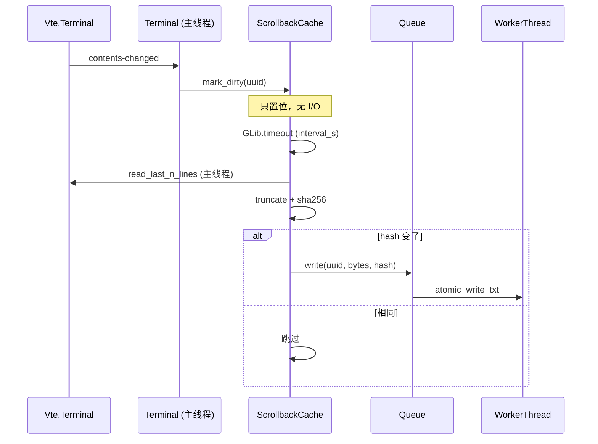
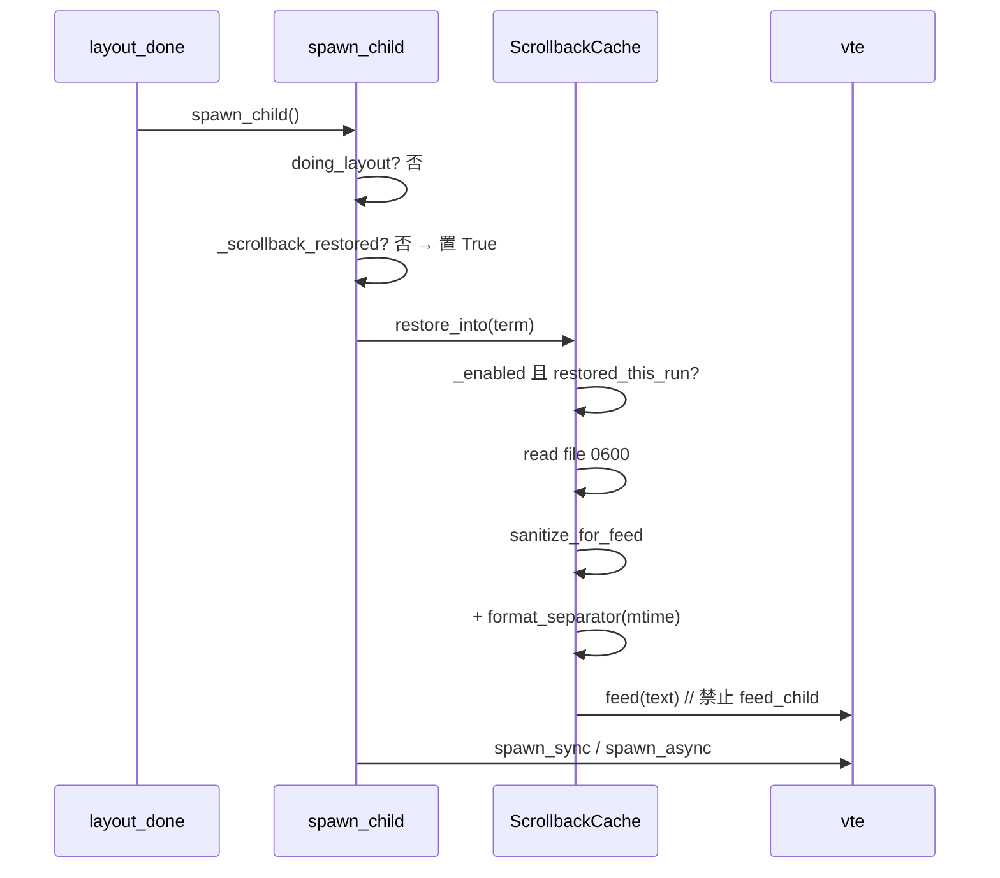

# 子方案 B：滚动缓冲区文字缓存（Scrollback Cache）

> 对应主文档：`docs/session-restore-design.md` §B、§1A.3 D2/D7/D9、§3.1/3.2b、§4.1 M1。  
> 代码基线：`TIIEHenry/terminator` @ `9f2d0b6`。文中 `file:line` 均基于该提交。  
> **范围**：纯文本视觉缓存；**不**恢复进程；私人机器不做隐私强制（排除列表/脱敏/首次警告见主文档 B.7）。  
> **依赖**：模块 A（`SessionManager`）提供的接口（B 只调这些，不直接读 A 的内部状态）：`is_owner()`、`restored_this_run`、`will_persist(terminal)`、`session_uuids()`、`finalize()`（内部调 B 的同步刷写）、`--clear-session`/首选项「清除」调 `ScrollbackCache().clear_all()`。
> **修订 r2（并行审查后）**：落实父级决议——扁平 `<uuid>.txt`（不加 hostname）；保留/删除改由 `will_persist` 决定；仅 `restored_this_run` 才回填；每终端只回填一次（`_scrollback_restored`），修正 `respawn` 参数误解；最终刷写在 `finalize()` 内同步完成后 `stop(join 1s)`；非属主实例禁用 B；孤儿清理用 `session_uuids()`；起始行用 `vadjustment.get_lower()`；修正 logger 版本描述；文件为 `scrollback.py`，`get_cache_dir` 放 `util.py`。
> **修订 r3（审查报告落盘后补漏）**：D5 多窗口 10s 缓冲期间不删缓存（`discard_uuids`）；纯函数拆到无 gi 依赖的 `scrollback_text.py`（`pytest --doctest-modules` 会导入模块）；新增 `feed_notice()` 供 A 的崩溃说明行；`will_persist` 补「最后一个终端 exit、A 保留旧快照」边界与 uuid 为 None 防御（r4）；80x24 回填后 rewrap 说明；NFS 扁平目录取舍；PR 顺序、glade 合并与工时 2.5–3 天。

---

## 0. 目标与非目标

| | 内容 |
|---|---|
| 目标 | 退出/崩溃后重开，每个终端顶部看到上次最后 N 行文字 + 分隔线；新 shell 提示符在其下 |
| 非目标 | 颜色（B.6 以后）、进程/环境/alternate screen、命令排除/ECHO 跳过（私人机器覆盖） |
| 默认 | `scrollback_cache=True`；路径 `~/.cache/terminator/scrollback/<uuid>.txt`（见 §8 与主文档冲突） |

---

## 1. VTE API 与版本分支（采集）

本环境未装 PyGObject/VTE；结论来自公开文档 + 仓库内已有用法（`plugins/logger.py`、`plugins/remote.py`）。目标机须用 `hasattr` / `Vte.get_*_version()` 实测。

### 1.1 版本探测（一次，模块加载时缓存）

```python
# terminatorlib/scrollback.py（或 session.py 内）
from gi.repository import Vte

def _vte_versions():
    major = Vte.get_major_version()
    minor = Vte.get_minor_version()
    micro = Vte.get_micro_version() if hasattr(Vte, 'get_micro_version') else 0
    return (major, minor, micro)

VTE_VER = _vte_versions()  # e.g. (0, 76, 0)
HAS_GET_TEXT_RANGE_FORMAT = hasattr(Vte.Terminal, 'get_text_range_format')
HAS_GET_TEXT_RANGE = hasattr(Vte.Terminal, 'get_text_range')
HAS_WRITE_CONTENTS_SYNC = hasattr(Vte.Terminal, 'write_contents_sync')
```

现有代码两种写法都不可照抄：
- `plugins/logger.py:22,44`：`vte_version = Vte.get_minor_version()`，`if self.vte_version < 72` —— **整数比较，只看 minor**。在 0.x 系列下结果正确，但忽略 major（未来 1.x 会误判），且 0.76+ 仍走 deprecated 判断依据。
- `plugins/remote.py:86-90`：拼成 `"0.72"` 再做**字符串**比较 `version < "0.72"` —— 字典序比较，如 `"0.100" < "0.72"` 为 True，会误走旧 API。

本模块一律：**能力用 `hasattr` 判定**，版本仅用 `(major, minor, micro)` 元组记日志/兜底。

### 1.2 导出最后 N 行（主线程，唯一允许碰 VTE 的路径）

| 优先级 | API | 自版本 | 用法 |
|---|---|---|---|
| 1 | `vte.get_text_range_format(Vte.Format.TEXT, start_row, 0, end_row, end_col)` | 0.72+ | 返回 `(text, length)`；取 `[0]` |
| 2 | `vte.get_text_range(start_row, 0, end_row, end_col, None)` | 更旧；0.76 起 deprecated | 返回 `(text, attrs)`。纯文本取 `[0]`。没有 HTML 导出时，`color=True` 用 `attrs` 写成 SGR |
| 3 | `vte.write_contents_sync(stream, Vte.WriteFlags.DEFAULT, None)` | 较广 | 写入 `Gio.MemoryOutputStream`，再按行截断 |

没有 `get_text_range_format` 时，颜色走第 2 行的 `attrs`。属性按 UTF-8 字节对齐，不是按码点：一个 3 字节字符占三条属性，颜色在第一条上。每行自己打开样式并在换行前复位。前景色一律记下（这个接口分不出“默认前景”）。背景色与 `get_color_background_for_draw` 相同则不写。PyGObject 在 VTE 0.68 上把下划线放在 `underline` 的 bit 0、删除线放在 bit 1。粗体不在这个结构里。

**行范围算法**（绝对行号；起始行不得小于 `get_vadjustment().get_lower()`，否则 scrollback 溢出淘汰后会请求已不存在的行。终端视图 `create_terminalbox` 已用同一 adjustment，见 `terminal.py:337`）：

```python
def read_last_n_lines(vte, n_lines: int) -> str:
    col, end_row = vte.get_cursor_position()  # (col, row) 绝对行号
    # 绝对行号不从 0 开始：scrollback 被淘汰后最早可读行 = vadjustment 下界
    lower = int(vte.get_vadjustment().get_lower())
    start_row = max(lower, end_row - max(0, n_lines - 1))
    # end_col：当前列；若只要整行，可用 vte.get_column_count()
    text = _export_range(vte, start_row, 0, end_row, col)
    if not text:
        return ''
    # 防御：再按行截一次，防止 API 多给
    lines = text.split('\n')
    if len(lines) > n_lines:
        lines = lines[-n_lines:]
    return '\n'.join(lines)
```

### 1.3 `scrollback_infinite` 约束

`terminal.py:911-915`：`scrollback_infinite=True` 时 `set_scrollback_lines(-1)`。  
**禁止**无范围的 `write_contents_sync` 全量导出（会堵主线程）。  
规则：

1. 永远用「最后 N 行」的 `get_text_range*`（N=`scrollback_cache_lines`，默认 2000）。
2. 仅当 `get_text_range*` 皆不可用时才回退 `write_contents_sync`，且必须：
   - 在主线程读到 memory stream；
   - 立刻按行/字节截断后再交给工作线程；
   - 若 `config['scrollback_infinite']` 且无法做范围读取 → **跳过该终端本次刷写**并 `dbg` 一次（避免卡死）。

### 1.4 回填 API（硬规则）

| 调用 | 作用 | 本模块 |
|---|---|---|
| `self.vte.feed(data)` | 写入**显示缓冲**（像终端输出） | **必须用这个** |
| `Terminal.feed` → `vte.feed_child`（`terminal.py:1850-1855`） | 送给 **PTY/shell**（当命令敲） | **禁止**；单测锁死 |

现有错误提示已用 `self.vte.feed(_('Unable to find a shell'))`（`terminal.py:1714`），证明 display-feed 路径可用。

回填前：

1. 读文件 → `str`（UTF-8，`errors='replace'`）。
2. **清洗控制字符**（可靠性，非隐私）：去掉 C0（保留 `\t` `\n` `\r`）、C1、ESC/`OSC`/`CSI` 序列，防止缓存被篡改后改标题/剪贴板。
3. `\n` → `\r\n`（VTE display feed 惯例；与主文档 §3.1 一致）。
4. 追加分隔线（见 §4.4）。
5. `self.vte.feed(text)`（`str` 即可：PyGObject 对 guint8 数组参数自动编码，现有 1714 依赖此行为）。

**尺寸注意**：`Terminal.__init__` 末尾 `self.vte.set_size(80, 24)`（`terminal.py:206`）。`layout_done` 中 spawn 时窗口通常已 realize 并分配了真实尺寸，但若尚未 size-allocate，回填按 80 列排版，随后 resize 时 VTE 会 rewrap（VTE 0.40+ 支持 rewrap，文字不丢，仅可能出现长行折行位置与上次不同）。可接受，不做额外处理；B0 真机确认。

---

## 2. 类设计与签名

**定稿**：新建 `terminatorlib/scrollback.py`（不并入 `session.py`）；纯文本函数（§2.2 中除 `export_vte_text`/`read_last_n_lines` 外全部）放 **`terminatorlib/scrollback_text.py`，该文件不得 import gi/Gtk/Vte**——`pytest.ini` 为 `addopts = --doctest-modules`，会导入 `terminatorlib/` 下所有模块，B1 单测须在无 PyGObject 环境也能跑；`scrollback.py` 内 `from gi.repository import Vte` 照常（与其他模块一致，需 gi 的测试环境由 M0 解决）；`get_cache_dir()` 放 `terminatorlib/util.py`。`SessionManager` 调用 `ScrollbackCache` 的公开方法；B 只通过 §0 依赖中列出的 A 接口读取会话状态。

### 2.1 `ScrollbackCache`（Borg 或普通单例）

```python
class ScrollbackCache(Borg):
    """滚动缓冲文字缓存。主线程读 VTE，工作线程写盘。"""

    # Borg 属性须默认 None，在 prepare_attributes 初始化
    _enabled = None
    _dir = None                 # Path: ~/.cache/terminator/scrollback
    _dirty = None               # set[str]  uuid 字符串
    _last_hash = None           # dict[uuid -> str] 内容哈希，跳过相同写
    _timer_id = None            # GLib timeout id
    _worker = None              # 单工作线程 + queue.Queue
    _fail_count = None          # OSError 连续失败计数
    _disabled_by_error = None   # 连续失败后停写
    _uuid_re = None             # 文件名校验

    def __init__(self):
        Borg.__init__(self, self.__class__.__name__)
        self.prepare_attributes()

    def prepare_attributes(self): ...

    # ---- 生命周期 ----
    def start(self) -> None:
        """仅当 config['scrollback_cache'] 且 SessionManager().is_owner()（持锁的无参主实例）
        且目录属主 == euid 时：建目录、启工作线程、启周期定时器、cleanup_startup()。
        否则 _enabled=False：mark_dirty/flush/restore 全部 no-op（非属主实例禁用 B）。"""

    def stop(self, join_timeout: float = 1.0) -> None:
        """停定时器；向队列投 stop；worker.join(join_timeout)（最多 1s，超时放弃，
        worker 为 daemon 线程，不阻塞退出）。不再在此刷写——最终刷写由 finalize 先行完成。"""

    def reconfigure(self) -> None:
        """首选项变更：关→开 / 开→关（关则 stop + 删目录）。"""

    # ---- 脏标记（主线程，contents-changed）----
    def mark_dirty(self, terminal) -> None:
        """只把 str(terminal.uuid) 放入 _dirty；禁止 I/O。
        terminal.uuid 为 None（未经 Factory 构造，如 prefseditor.py:2270 的 __main__ 调试入口）时直接忽略；
        flush_all/on_terminal_close 同样跳过 uuid 为 None 的终端。"""

    # ---- 刷写 ----
    def flush(self, terminal, *, sync: bool = False) -> None:
        """主线程：若 dirty 则 read_last_n_lines → 写（sync 直接写 / 否则投递队列）。"""

    def on_terminal_close(self, terminal) -> None:
        """Terminal.close() 调用（VTE 仍可用时）：
        SessionManager().will_persist(terminal) → flush(terminal, sync=True) 保留；
        否则 delete_uuid(str(terminal.uuid))。B 不直接读 final_saving。"""

    def flush_all(self, *, sync: bool = False) -> None:
        """对 Terminator().terminals 中 will_persist 的终端逐个读取并写盘。
        sync=True：**在主线程直接 atomic_write**（不经队列），供 SessionManager.finalize() 调用，
        保证返回时文件已落地；sync=False：投递队列（周期路径）。"""

    def _on_interval(self) -> bool:
        """GLib 周期回调：轮转刷 1–N 个 dirty 终端（见性能）；return True 保活。"""

    # ---- 恢复 ----
    def restore_into(self, terminal) -> bool:
        """前置：_enabled 且 SessionManager().restored_this_run。
        读 <uuid>.txt → 清洗 → 拼分隔线 → terminal.vte.feed；成功 True。
        无文件 / 未恢复会话 / 校验失败 → False。一次性由调用方 _scrollback_restored 保证。"""

    # ---- 清理 ----
    def delete_uuid(self, uuid_str: str) -> None: ...

    def discard_uuids(self, uuids: set[str]) -> None:
        """A 在 D5 缓冲过期（10s 内未发生整体退出）时调用：删除这批已关闭窗口终端的缓存。
        与 will_persist 配套：窗口关闭进入缓冲时 will_persist 返回 True（文件先保留），
        缓冲被丢弃时由 A 调本函数补删。"""

    def feed_notice(self, terminal, text: str) -> None:
        """向 terminal.vte.feed 一行灰色说明（清洗后 + SGR 90 + \\r\\n）。
        供 A 的崩溃保护说明（1A.5）、目录回退 home 说明（1A.7）使用；须在 spawn 前调用。
        不受 restored_this_run 限制（崩溃保护恰是 restored_this_run=False 的场景）。"""
    def clear_all(self) -> None:
        """清空 dirty 与队列、停写后删除 scrollback/ 目录。
        调用方：A 处理 `--clear-session`（启动早期，B 尚未 start 也必须可用——只做文件删除）；
        首选项「清除会话与缓存」；关闭 scrollback_cache 开关。"""

    def cleanup_startup(self) -> None:
        """启动（仅属主）：删 *.tmp；删超 TTL；按总量上限删最旧；
        孤儿：live = SessionManager().session_uuids()（会话中所有 Terminal uuid 的 str 集合）；
        live 为 None（无会话/加载失败/崩溃保护跳过）时**不删孤儿**，只做 TTL。"""

    # ---- 路径 ----
    def path_for(self, uuid_str: str) -> str:
        """校验 uuid 正则后返回绝对路径；非法则 raise/返回 None。"""
```

### 2.2 辅助函数（模块级，便于单测）

```python
UUID_FILE_RE = re.compile(
    r'^[0-9a-f]{8}-[0-9a-f]{4}-[0-9a-f]{4}-[0-9a-f]{4}-[0-9a-f]{12}$'
)

# 放在 terminatorlib/util.py（与 get_config_dir util.py:212-221 并列；A 的 get_state_dir 同处）
def get_cache_dir() -> str:
    """$XDG_CACHE_HOME/terminator，缺省 ~/.cache/terminator。
    B 使用 os.path.join(get_cache_dir(), 'scrollback')。"""

def export_vte_text(vte, start_row, start_col, end_row, end_col) -> str:
    """§1.2 版本分支；无可用 API 返回 ''。"""

def read_last_n_lines(vte, n: int) -> str: ...

def truncate_utf8_bytes(data: bytes, max_bytes: int) -> bytes:
    """从尾部保留 ≤ max_bytes，且不劈开 UTF-8 多字节序列。"""

def truncate_lines_and_bytes(text: str, max_lines: int, max_kb: int) -> str:
    """先按行取尾部 max_lines，再按 UTF-8 字节上限从尾截断到整行边界。"""

def sanitize_for_feed(text: str) -> str:
    """去 C0/C1/ESC 序列；保留 \t \n \r；结果可安全 vte.feed。"""

def normalize_newlines_for_feed(text: str) -> str:
    """\r\n|\r|\n → \r\n。"""

def format_separator(saved_at: datetime | None) -> str:
    """gettext 分隔线，见 §4.4。"""

def atomic_write_txt(path: str, data: bytes, mode: int = 0o600) -> None:
    """mkstemp(dir=同目录) → fchmod → write → flush（**不** fsync，主文档 B）→ os.replace。"""
```

### 2.3 工作线程协议

```
主线程                          工作线程
  |  q.put(('write', uuid, text_bytes, hash))
  |  q.put(('delete', uuid))
  |  q.put(('stop',))
  | ----------------------------→  loop:
  |                                 write: atomic_write；更新失败计数回调（GLib.idle_add）
  |                                 delete: os.unlink 忽略 FileNotFound
  |                                 stop: break
```

- 工作线程**禁止**导入/调用 VTE、GTK、`Terminal` 实例方法。
- 写失败：`GLib.idle_add(cache._on_write_failed, exc)`；连续 ≥3 次 → `_disabled_by_error=True` 并停定时器；成功则清零。
- 哈希相同（主线程算 `hashlib.sha256(text_bytes).hexdigest()`）则不投递 write。

---

## 3. 挂钩点（file:function:line）

| # | 时机 | 位置 | 动作 |
|---|---|---|---|
| H1 | 建终端、连信号 | `terminal.py` `connect_signals` ≈ **457–532**（建议紧挨 `window-title-changed` **521**） | 若 `config['scrollback_cache']`：`self.cnxids.new(self.vte, 'contents-changed', self._on_scrollback_contents_changed)`；handler 只调 `ScrollbackCache().mark_dirty(self)`（非属主实例内部 no-op） |
| H2 | 首次 spawn | `terminal.py` `spawn_child` **1654**：在 `doing_layout` 早退（**1659–1661**）**之后**、`spawn_sync/async`（**1738/1752**）**之前** | `if not self._scrollback_restored: self._scrollback_restored = True; ScrollbackCache().restore_into(self)`。**不依赖 `respawn` 参数**（见 §3.2） |
| H3 | 关单个终端 | `terminal.py` `close` **270**：在 `cnxids.remove_widget(self.vte)`（**273**）**之前**（VTE 仍可用） | `ScrollbackCache().on_terminal_close(self)` → `will_persist(self)` 真则同步写保留，假则删文件。注意 `Container.closeterm` 先 `deregister_terminal`（`container.py:138`）再 `close()`（**139**），`will_persist` 不能依赖终端仍在 `Terminator().terminals` |
| H4 | 窗口销毁 / 退出 | A：`window.py` `on_destroy_event` **295** 开头（关终端循环 **298–307** 之前）调 `SessionManager().finalize()` | `finalize()` 内：`save_now(final=True)` → `ScrollbackCache().flush_all(sync=True)`（主线程同步写）→ `ScrollbackCache().stop(join_timeout=1.0)`。B 不自挂此处 |
| H5 | SIGTERM/SIGHUP | A 的 `install_signal_handlers` → 同一 `finalize()` | 同 H4；`try/finally` 保证 `Gtk.main_quit()` |
| H6 | Reset+Clear | `terminal.py` `key_reset_clear` **2176–2177**（`vte.reset(True, True)`） | 清 dirty + `delete_uuid(str(self.uuid))`；随后新输出照常标脏重建 |
| H7 | 普通 Reset | `key_reset` **2173–2174**（`reset(True, False)` 不清 scrollback） | 不删缓存 |
| H8 | 启动 | 入口 `terminator`：A 完成 `acquire_lock()` + `load()`（确定 `is_owner`/`restored_this_run`/`session_uuids`）之后、`create_layout` 之前 | `ScrollbackCache().start()`（含 `cleanup_startup()`）。必须早于 `layout_done`→`spawn_child`，否则回填时 B 未启用 |
| H9 | `--clear-session` / 首选项清除 / 关开关 | A（`terminator` 入口、prefseditor 会话页） | A 调 `ScrollbackCache().clear_all()`；关开关另调 `reconfigure()` |
| H10 | uuid 时机 | `factory.py` `make` **94**：`inject_uuid` 在 `Terminal.__init__` **之后** | `__init__` 内不读 uuid；`create_layout` **1984–1985** 写回会话 uuid，早于 `layout_done`→`spawn_child`（`terminator.py:325–327`），回填时 uuid 已是会话值 |
| H11 | Relaunch Command | `terminal_popup_menu.py:309` `terminal.spawn_child()`（held_open 后） | 因 `_scrollback_restored` 已为 True，**不**再回填 |

### 3.1 `Terminal` 最小增量

```python
# terminal.py 类属性（约 102–110 行附近，与 pid/directory 并列）
_scrollback_restored = False

def _on_scrollback_contents_changed(self, _vte):
    try:
        ScrollbackCache().mark_dirty(self)
    except Exception as ex:
        dbg('scrollback mark_dirty failed: %s' % ex)  # 缓存失败不影响终端

# connect_signals（≈521 附近）：
if self.config['scrollback_cache']:
    self.cnxids.new(self.vte, 'contents-changed',
                    self._on_scrollback_contents_changed)

# spawn_child：doing_layout 早退之后、spawn_* 之前
if not self._scrollback_restored:
    self._scrollback_restored = True        # 无论有无文件，只尝试一次
    try:
        ScrollbackCache().restore_into(self)  # 内部检查 _enabled + restored_this_run
    except Exception as ex:
        dbg('scrollback restore failed: %s' % ex)

# close() 开头（remove_widget 之前）：
try:
    ScrollbackCache().on_terminal_close(self)
except Exception as ex:
    dbg('scrollback close hook failed: %s' % ex)

# key_reset_clear：
self.vte.reset(True, True)
ScrollbackCache().delete_uuid(str(self.uuid))
```

### 3.2 `respawn` 参数误解（审查修正）

`reconfigure` 中 `self.cnxids.new(self.vte, 'child-exited', self.spawn_child, True)`（`terminal.py:718`）。VTE 的 `child-exited` 回调签名是 `(terminal, status)`，Signalman 再追加用户参数 `True`，实际调用为：

```
spawn_child(widget=vte, respawn=<exit status int>, debugserver=True)
```

因此：
- `respawn` 收到的是**退出码**（常为 0），并非布尔 `True`；`if respawn is False`（**1663**）对 0 也为假，"恰好"不抢焦点，但 `debugserver` 被误置为 True；
- 任何「`respawn=True` 不回填」的判断都**不可靠**；`Relaunch Command`（`terminal_popup_menu.py:309`）以 `respawn=False` 调用，若按参数判断会二次回填。

结论：B **只用显式实例标志 `_scrollback_restored`** 判定是否回填，不读 `respawn`。（`debugserver` 误置属既有行为，B 不修；记录给后续 PR。）

---

## 4. 存储、格式、分隔线

### 4.1 路径

```
$XDG_CACHE_HOME/terminator/scrollback/<uuid>.txt
缺省：~/.cache/terminator/scrollback/<uuid>.txt
```

- 目录 `os.path.join(util.get_cache_dir(), 'scrollback')`，`makedirs(..., mode=0o700, exist_ok=True)`；写前检查属主 == `os.geteuid()`，不符（如 sudo）→ B 禁用。
- 文件名：`str(uuid.UUID)` → 36 位小写+连字符；写入前 `UUID_FILE_RE.match`；拒绝 `../` 等。
- **定稿：扁平 `<uuid>.txt`，不加 hostname 子目录**（私人机器，父级决议）。主文档 B.2 的 `<hostname>/` 需勘误，见 §8。

### 4.2 文件内容

纯 UTF-8 文本 = 截断后的最后 N 行（无元数据头）。  
可选：同行侧车不需要；`saved_at` 用 `os.path.getmtime` 生成分隔线时间即可。

上限（磁盘卫生，D9）：

| 键 | 默认 | 作用 |
|---|---|---|
| `scrollback_cache_lines` | 2000 | 行数上限 |
| `scrollback_cache_max_kb` | 512 | 单文件字节上限（UTF-8 边界截断） |
| `scrollback_cache_total_mb` | 20 | 目录总量；超出则按 mtime 删最旧 |
| `scrollback_cache_ttl_days` | 7 | 启动清理过期 |

### 4.3 原子写

```python
fd, tmp = tempfile.mkstemp(dir=dirpath, prefix='.', suffix='.tmp')
try:
    os.fchmod(fd, 0o600)
    os.write(fd, data)          # 不 fsync（主文档 B：仅 A fsync）
finally:
    os.close(fd)
os.replace(tmp, final_path)
```

主文档明确 **B 不 fsync**（A 才 fsync）。异常时 `os.unlink(tmp)` 清理临时文件。

### 4.4 分隔线（gettext）

主文档 1A.6：

```text
──── 以上为上次会话的输出（仅文字快照，进程未恢复）· 10-10 15:00 ────
```

```python
from terminatorlib.translation import _

def format_separator(mtime: float | None) -> str:
    if mtime:
        # 用户区 Asia/Shanghai；显示用本地时间
        ts = datetime.fromtimestamp(mtime).strftime('%m-%d %H:%M')
    else:
        ts = ''
    # 前景色 90：用 VTE OSC/SGR 需极克制——主文档要求「只用前景色 90」
    # 推荐嵌入简单 SGR（回填清洗会放行我们自己追加的这段，或清洗后另拼）：
    label = _('──── 以上为上次会话的输出（仅文字快照，进程未恢复）· {time} ────').format(time=ts)
    return '\r\n\x1b[90m' + label + '\x1b[0m\r\n'
```

注意：`sanitize_for_feed` 会剥 ESC；因此顺序必须是：**先清洗历史文本 → 再拼接分隔线（含 SGR）→ feed**。  
目录缺失说明行：A 在 `sanitize` 把目录回退到 home 时记录到终端（如 `terminal._restore_notice`），`layout_done` 内 spawn 前调 `ScrollbackCache().feed_notice(term, ...)`；B 不检测目录。
「上次此处为远程连接」：当前无任何 ssh 检测来源，**M1 不做**（需要 A 在保存时记录前台进程，列为以后），B 只提供 `feed_notice` 能力。

---

## 5. 与模块 A 的 uuid 映射与接口契约

| A 接口 | B 用途 | 语义 |
|---|---|---|
| `is_owner()` | `start()` 是否启用 B | 无参启动且持锁的主实例；`-l X`/`-u` 非属主等 → B 全部 no-op（不写、不删、不回填） |
| `restored_this_run`（bool） | `restore_into` 前置 | 本次启动确实从会话恢复了布局（非 `--no-restore`、非崩溃保护跳过、load 成功） |
| `will_persist(terminal)` | `on_terminal_close` 保留/删除 | 该终端会出现在下次会话中 → 保留；否则删除。**须覆盖 D5**：关闭非最后一个窗口时（`final_saving` 尚为 False），该窗口终端已记入 10s 缓冲 → 返回 True。非属主实例恒 False（但 B 已禁用，不会调用） |
| ↳ 边界：最后一个终端 `exit` | — | 流程：`Container.closeterm` → `deregister_terminal`（0 终端，`terminator.py:175-178` 销毁窗口 → `finalize()`，A 因 0 终端**不覆盖**会话）→ 回到 `container.py:139` `widget.close()` → `on_terminal_close`。磁盘上的旧快照仍含该 uuid，故 `will_persist` **须返回 True**（判定依据是「将用于下次恢复的会话是否含此 uuid」，不是 `final_saving` 标志何时置位）。否则会出现布局恢复了但该终端内容被删 |
| （A 调 B）`discard_uuids(set)` | D5 缓冲过期 | 缓冲被丢弃时 A 传入该窗口终端 uuid 集，B 删除对应文件 |
| （A 调 B）`feed_notice(term, text)` | 崩溃说明 / 目录回退说明 | A 在 spawn 前、`layout_done` 内调用 |
| `session_uuids()` | 孤儿清理 | 已加载会话中 Terminal uuid 的 `set[str]`；无会话返回 `None` |
| `finalize()` | 最终刷写 | A 内顺序：`save_now(final=True)` → `ScrollbackCache().flush_all(sync=True)` → `ScrollbackCache().stop(join_timeout=1.0)` |
| （A 调 B）`clear_all()` | `--clear-session`、首选项清除 | B 未 start 时也可调用 |

```mermaid
sequenceDiagram
    participant Main as terminator 入口
    participant Sess as SessionManager (A)
    participant Cache as ScrollbackCache (B)
    participant Layout as create_layout / layout_done
    participant Term as Terminal

    Main->>Sess: acquire_lock(); load()
    Main->>Cache: start()  // is_owner? 否→禁用
    Cache->>Sess: session_uuids()
    Cache->>Cache: cleanup_startup（tmp/TTL/总量/孤儿）
    Main->>Layout: create_layout('__last_session__')
    Layout->>Term: create_layout → uuid = 会话 uuid
    Layout->>Term: layout_done → spawn_child
    Term->>Term: _scrollback_restored = True
    Term->>Cache: restore_into(self)
    Cache->>Sess: restored_this_run?
    Cache->>Term: vte.feed(历史 + 分隔线)
    Term->>Term: spawn_sync/async

    Note over Term,Cache: 运行中：contents-changed → mark_dirty；周期主线程读 → 队列写

    Note over Main,Cache: 退出（on_destroy_event 开头 / SIGTERM）
    Sess->>Sess: finalize(): save_now(final=True)
    Sess->>Cache: flush_all(sync=True)  // 主线程直接写
    Sess->>Cache: stop(join_timeout=1.0)
    Term->>Cache: close → on_terminal_close → will_persist? 保留 : 删除
```

规则摘要：
- 会话叶子 `uuid` 与缓存文件名是同一个 `str(UUID)`。
- `finalize()` 之后 `close()` 再调 `on_terminal_close`：`will_persist` 为真时 `flush(sync=True)` 内容未变（哈希相同）即跳过，不重复写；worker 已停也不影响（sync 路径不经队列）。
- 孤儿清理只在属主实例、且 `session_uuids()` 非 None 时进行。
- 若 D5 缓冲期间进程崩溃：缓冲中窗口的缓存残留，下次启动若不在会话 uuid 集内则被孤儿清理删除；若会话也没写进该窗口，则一并丢失（与 A 语义一致）。
- **NFS 共享 home**：扁平目录下，A 的会话按 `session-<hostname>.json` 区分，而 B 不区分主机——机器 X 启动时会把机器 Y 会话的缓存当孤儿删除。私人单机可接受，**明确记为已知局限**；若将来多机共享 home，改为 `scrollback/<hostname>/` 即可（只改 `path_for`/`cleanup_startup`）。
- 新开（非恢复）的终端：`restore_into` 因 uuid 无对应文件直接返回；即使 `restored_this_run` 为 True 也无副作用。

## 6. 时序图

### 6.1 周期刷写



### 6.2 恢复



### 6.3 关终端 vs 退出

```mermaid
flowchart TD
    A[Terminal.close → on_terminal_close] --> B{SessionManager().will_persist(term)?}
    B -->|是| C[flush sync 写盘保留]
    B -->|否| D[delete_uuid 删文件]
    C --> E[cnxids.remove_widget + kill shell]
    D --> E
```

---

## 7. 配置键（与主文档一致）

| 键 | 类型 | 默认 | UI |
|---|---|---|---|
| `scrollback_cache` | bool | `True` | 会话页 |
| `scrollback_cache_lines` | int | `2000` | 会话页 |
| `scrollback_cache_interval_s` | int | `20` | 仅配置文件 |
| `scrollback_cache_max_kb` | int | `512` | 仅配置文件 |
| `scrollback_cache_total_mb` | int | `20` | 仅配置文件 |
| `scrollback_cache_ttl_days` | int | `7` | 仅配置文件 |
| `scrollback_cache_exclude_profiles` | list(str) | `[]` | 可保留空；私人机器不强调 |
| `scrollback_cache_exclude_commands` | list(str) | `[]` | 不做强制 |

依赖：`restore_last_session`；未恢复会话（`restored_this_run=False`）时不回填；非属主实例 B 禁用（设置页 B 依赖 A 置灰，主文档 1A.4）。

---

## 8. 与主文档的冲突 / 需对齐项（r2 已按父级决议定稿）

| # | 项 | 主文档 | 本子方案（定稿） | 主文档需勘误 |
|---|---|---|---|---|
| 1 | 缓存路径 | B.2：`scrollback/<hostname>/<uuid>.txt` | **扁平 `scrollback/<uuid>.txt`**（私人机器） | 是：B.2 删 hostname |
| 2 | 保留/删除依据 | B.3：`SessionManager.final_saving=True` 时保留 | `SessionManager().will_persist(terminal)` | 是：B.3 改写 |
| 3 | 回填条件 | B.4：「只在首次 spawn 回填（`respawn=True` 不回填）」 | `restored_this_run` + 每终端一次 `_scrollback_restored`；`respawn` 实为退出码，不可用 | 是：B.4 改写，并注明 child-exited 参数 |
| 4 | 最终刷写 | B.3：`close()` 与 A.4 退出/信号路径分别 `flush(term)` | 统一在 `SessionManager.finalize()` 内 `flush_all(sync=True)` → `stop(join 1s)` | 是：A.4/B.3 合并描述 |
| 5 | 模块文件 | 2.F：`ScrollbackCache` 放 `session.py`，`get_cache_dir` 放 session | `scrollback.py`；`get_cache_dir` 放 `util.py` | 是：2.F |
| 6 | 孤儿清理 | B.5：「持锁后删会话中不存在的 uuid」 | `session_uuids()`；None 时不删孤儿 | 小：补接口名 |
| 7 | 非属主实例 | 未写明 B 行为 | B 全部 no-op | 是：A.6/B 补一句 |
| 8 | clear-on-reset | 未单列 | `reset_clear` 删缓存 | 是：B.5 补一句 |
| 9 | `--clear-session` | 1A.5 | A 调 `ScrollbackCache().clear_all()` | 小 |
| 10 | 主文档 1.1 #9 | 「全仓库没有 `get_text*` 调用」 | 实际 `logger.py`、`remote.py`、`mousefree_url_handler.py:103` 均有 `get_text_range*` | 是：措辞改为「没有序列化/回读 scrollback 的调用」 |
| 12 | D5 与缓存删除 | B.3 只按 final_saving 区分 | `will_persist` 覆盖缓冲窗口 + `discard_uuids` | 是：B.3 补 D5 |
| 15 | 最后一个终端 exit | 1.3-4 只说不覆盖会话 | B 同步保留其缓存（`will_persist` 按磁盘快照判定） | 是：B.3 补一句 |
| 13 | NFS / 主机隔离 | 会话按 hostname | B 扁平，跨主机会互删孤儿（已知局限） | 是：B.5 记一笔 |
| 14 | 工时 | M1 B 2–2.5 天 | 2.5–3 天 | 是：4.1 |
| 11 | fsync / 隐私 / `CACHEDIR.TAG` | B 不 fsync；隐私已撤；TAG 可选 | 一致；TAG 不实现 | 否 |

## 9. 有序、PR 级任务（M1-B，约 2.5–3 人日，审查后上调）

| PR/提交 | 内容 | 预估 | 验收 |
|---|---|---|---|
| **B0** | 真机确认 VTE：`hasattr` 分支、`get_cursor_position` 绝对行号与 `get_vadjustment().get_lower()` 在 scrollback 溢出后的关系；记入 M0 清单 | 0.25d | 笔记可贴 M0 |
| **B1** | `util.get_cache_dir` + `scrollback_text.py`（无 gi）：路径校验/`truncate_*`/`sanitize`/`atomic_write`/`format_separator` + 单测 | 0.5d | 无 PyGObject 环境 `pytest` 绿（含 doctest 收集） |
| **B2** | `ScrollbackCache`：`start`（`is_owner` 门控）、dirty、interval、主线程读、工作线程写、`flush_all(sync)`、`stop(join 1s)`、OSError 退避 | 0.5d | 手工：输出后 ≤20s 出现文件 0600；`-u` 第二实例不产生文件 |
| **B3** | 挂钩 H1/H3/H6；`discard_uuids`；与 A 的 `finalize()`/`will_persist`（含 D5 缓冲）联调（H4/H5 由 A 落地）。**排在 A4（destroy 顺序）、A6（保留规则）之后** | 0.75d | 关单终端文件删；整窗退出文件留；关窗 A 后 10s 内关窗 B → 两窗缓存都在；超过 10s → A 窗缓存被删 |
| **B4** | `spawn_child` 回填（H2，`_scrollback_restored`）；`feed_notice`；禁止 `feed_child` 单测；分隔线 gettext。**排在 A5（恢复/`restored_this_run`）之后** | 0.5d | `seq 1 5000` 重开见末 2000 行+分隔线；Relaunch/exit_action=restart 不二次回填 |
| **B5** | 启动清理 TTL/孤儿（`session_uuids()`）/总量；`clear_all` 供 A 的 `--clear-session` 与首选项；关开关实时生效（停写+删目录 / 开→`start`）。**首选项 glade 改动与 A8 会话页合并为一个 PR**（避免 `preferences.glade` 冲突） | 0.5d | 3.2b 清单 |

顺序依赖：B1、B2 不依赖 A，第一天可开；B3 在 A4/A6 后、B4 在 A5 后；B5 与 A8 合并。`terminal.py` 的 `close`/`spawn_child`/`connect_signals` 同时被 A3、B3、B4、C7、E3 修改，建议串行合并。A 需先提供 `is_owner`/`restored_this_run`/`will_persist`/`session_uuids`/`finalize` 骨架（可先 stub），B3/B4 才能端到端验收。

---

## 10. 测试计划（B 专项）

### 10.1 单元（无显示器）

- `truncate_utf8_bytes`：劈在多字节中间时向前借位。
- `truncate_lines_and_bytes`：行数与 KB 同时约束。
- `sanitize_for_feed`：`\x1b]0;title\x07`、CSI、C1 被剥；`\t\n\r` 保留。
- `atomic_write_txt`：写到一半抛错 → 旧文件不变；成品 mode `0o600`。
- `path_for`：非法 uuid 拒绝。
- `restore` 路径 mock：断言调用 `vte.feed`，**断言未调用 `feed_child`**（patch `Vte.Terminal.feed_child`）。
- `export_vte_text`：mock 三种 API 分支（`hasattr` 判定，不用版本字符串）。
- `read_last_n_lines`：mock `get_vadjustment().get_lower()=1000`、cursor row=1500、N=2000 → start_row=1000（不为 0 / 负数）。
- 回填一次性：同一终端连续调用 `spawn_child` 两次（模拟 Relaunch），`vte.feed` 只被调用 1 次。
- `restored_this_run=False` 时不 feed；`is_owner()=False` 时 `start` 后 mark_dirty/flush 不产生文件。
- `on_terminal_close`：`will_persist` 真→文件存在，假→文件删除。
- `cleanup_startup`：`session_uuids()` 返回 None 时孤儿保留，返回集合时删除集合外文件。
- `finalize` 顺序：`flush_all(sync=True)` 返回时文件已在磁盘（不依赖 worker）。
- `discard_uuids`：删除给定 uuid 文件，非法 uuid 忽略。
- `terminal.uuid=None` 时 mark_dirty/flush/on_terminal_close 不抛异常、不写文件。
- 最后一个终端 `exit`：mock A 保留旧快照且 `will_persist=True` → 缓存保留。
- `feed_notice`：调用 `vte.feed` 一次、文本经清洗，`restored_this_run=False` 也生效。
- `import terminatorlib.scrollback_text` 在无 gi 环境成功。

### 10.2 集成 / 手工

| 场景 | 期望 |
|---|---|
| `seq 1 5000` 后退出重开 | 约最后 2000 行 + 灰色分隔线，下方新提示符 |
| 关闭单个分屏终端 | 对应 `<uuid>.txt` 删除 |
| `Ctrl+Shift+G`（reset_clear） | 缓存文件删除 |
| `scrollback_infinite` + 大输出 | UI 无 >50ms 卡顿；文件仍 ≤ max_kb |
| 磁盘满 / 只读 | 不崩、不挡退出；退避后停写 |
| `sudo terminator` | 不写坏 root/user 混属主文件 |
| 关 `scrollback_cache` | 立即停写并删目录 |
| TTL 8 天前的文件 | 启动后被删 |
| exit_action=restart（`child-exited` 传退出码） | 不二次回填旧缓存 |
| exit_action=hold → 菜单 Relaunch Command | 不二次回填 |
| `terminator --no-restore` | 不回填；缓存照常写 |
| `terminator -u`（第二实例） | 不写、不删、不回填 |
| `terminator --clear-session` | scrollback/ 目录被删 |
| D5：两窗口，先关 A，10s 内关 B，重开 | 两窗口内容都回填 |
| D5：先关 A，等 >10s，再关 B | A 窗终端缓存已删，仅 B 回填 |
| 单窗口单终端里 `exit`，重开 | 布局按旧快照恢复，该终端历史仍回填 |
| 崩溃保护触发后启动 | 不回填历史，第一个终端有一行说明（`feed_notice`） |

### 10.3 性能

- 10 终端 × 大 scrollback：每 tick 只刷 1–2 个 dirty（轮转），主线程单次读 < 50ms。
- 工作线程队列堆积上限：丢弃中间旧任务、只保留每 uuid 最新一次 write。

---

## 11. 风险与缓解

| 风险 | 等级 | 缓解 |
|---|---|---|
| 误用 `Terminal.feed` / `feed_child` 把缓存当命令执行 | **P0** | 代码审查 + 单测；回填函数命名 `restore_into` 内只碰 `terminal.vte.feed` |
| `scrollback_infinite` 全量 `write_contents_sync` 卡死 UI | P0 | 优先 range API；infinite 且无 range 则跳过 |
| `contents-changed` 极高频 | P1 | 只置 dirty；20s 批量；每 tick 限流 |
| uuid 在 `__init__` 尚未 inject | P2 | 刷写/路径阶段再读 uuid；Factory 保证运行时已有 |
| `close()` 先 `remove_widget` 再读 VTE | P0 | flush 必须在 **273 行之前**（已写 H3） |
| 依赖 `respawn` 判断导致重复回填 | P1 | 只用 `_scrollback_restored`（§3.2） |
| 退出时 worker 未写完 | P1 | `finalize` 内同步写；`stop` 只 join 1s，daemon 线程 |
| 起始行用 0 导致请求已淘汰行 | P2 | `max(get_lower(), ...)` |
| 非属主实例删掉主实例缓存 | P1 | `is_owner` 门控 + 孤儿清理仅属主 |
| 退出时先 `terminal.close()` 再保存 | P0 | A 在 `on_destroy_event` 开头调 `finalize()`，早于关终端循环 |
| 回填时尺寸仍为 80x24，resize 后 rewrap | P3 | 文字不丢；B0 真机观察；必要时改为 `GLib.idle_add` 在首个 size-allocate 后回填（但须仍早于 shell 输出，复杂度高，首版不做） |
| D5 缓冲期间删掉缓存导致恢复后无内容 | P1 | `will_persist` 覆盖缓冲窗口；过期由 `discard_uuids` 补删 |
| `--doctest-modules` 导入 gi 失败 | P2 | 纯函数放无 gi 的 `scrollback_text.py` |
| 清洗过严导致中文/emoji 损坏 | P2 | 只剥控制序列；UTF-8 `replace`；单测 CJK |
| 多实例 `-u` 写同一缓存 | — | 已消除：非属主实例 B 禁用 |
| logger 插件同时连 `contents-changed` | P3 | 无冲突（各自 handler） |

---

## 12. 实现伪代码（关键路径）

```python
def restore_into(self, terminal) -> bool:
    if not self._enabled or not SessionManager().restored_this_run:
        return False
    path = self.path_for(str(terminal.uuid))
    if not path or not os.path.isfile(path):
        return False
    with open(path, 'rb') as f:
        raw = f.read(self._max_bytes + 4).decode('utf-8', 'replace')
    body = normalize_newlines_for_feed(sanitize_for_feed(raw))
    sep = format_separator(os.path.getmtime(path))   # 清洗之后再拼（含 SGR 90）
    terminal.vte.feed(body + sep)                    # 绝不 terminal.feed / feed_child
    return True

def on_terminal_close(self, terminal):
    if not self._enabled:
        return
    if SessionManager().will_persist(terminal):
        self.flush(terminal, sync=True)
    else:
        self.delete_uuid(str(terminal.uuid))
```

```python
# A 侧（仅示意契约，由 A 子方案实现）
def finalize(self):
    try:
        self.save_now(final=True)
        cache = ScrollbackCache()
        cache.flush_all(sync=True)
        cache.stop(join_timeout=1.0)
    except Exception as ex:
        err('finalize failed: %s' % ex)
```

## 13. 清单对照（主文档 2.F / M1）

| 主文档要求 | 本子方案落点 |
|---|---|
| 主线程读 / 线程写 | §2.1 / §6.1 |
| `vte.feed` 非 `feed_child` | §1.4 / §10.1 |
| 0600/0700、TTL、上限、OSError | §4 / §2.1 `_on_write_failed` |
| 无隐私强制 | §0 / §8 |
| 与 A uuid 映射 / 接口契约 | §5 |
| clear 按钮 / `--clear-session` / 关开关删缓存 | H9 / `clear_all`（A 调用） |
| clear-on-reset | H6（主文档补一句） |

**Go**：B1 无依赖可立即开；B2–B5 在 A 提供 §5 接口（可先 stub）后进行。
