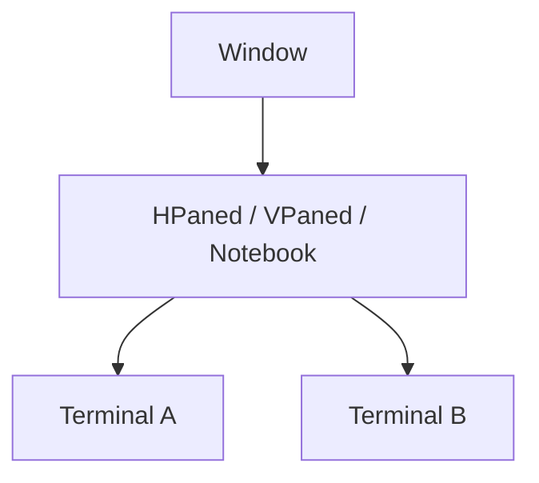
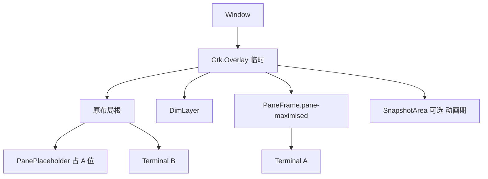
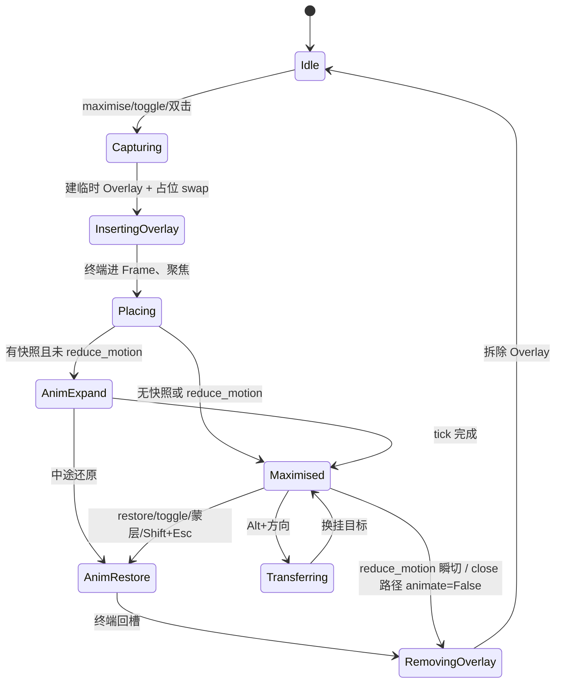

# D 子方案：Wave 风格单分屏浮层最大化（v2，审查后定稿）

> 对应主方案 §D（`docs/session-restore-design.md`）。代码基线 `9f2d0b6`。
> 范围：多分屏布局中把**一个**分屏以浮层铺满当前标签的窗格区域（四周约 12px、圆角绿边、背后暗化可见），带缩放动画；**不是**窗口最大化，**不是**旧 reparent zoom。左侧标签列表和原生标签条留在浮层外，仍然可以点。
> 里程碑：**M3**（**8–11 人天**）；内实施序：D0 遍历钩子 → D1a 占位/`swap_child` → D1b 临时 Overlay + `get_child`/`get_children()[0]` 审计 → D1c 放大/还原/关闭 → D2 交互 → D3 动画 → D-prefs。
> 本文件只写实现路径；**不改代码**。审查来源：`docs/reviews/findings-summary.md` + 父代理决策。

---

## 0. 目标与非目标

### 0.1 目标

| ID | 行为 | 验收 |
|---|---|---|
| D-T1 | 多分屏「最大化此分屏」→ 浮层铺满当前标签的窗格区域（标签列表和原生标签条留在外面），四周 12px，圆角 8px，`pane_accent_color` 2px 描边 + 阴影 | 对齐 Wave 截图 |
| D-T2 | 兄弟分屏原位、暗化 `rgba(0,0,0,0.55)` 仍可见且继续跑 | 背后输出继续滚动 |
| D-T3 | 放大 `pane_animation_expand_ms`（默认 200）ease-out / 还原 `pane_animation_restore_ms`（默认 160）；中途再触发反向 | vim 约 1 次 SIGWINCH |
| D-T4 | Shift+Esc（`restore_maximised`，**仅放大态消费**）、再点最大化、点蒙层、Ctrl+Shift+X 可还原 | 焦点回放大终端（D21） |
| D-T5 | Alt+方向键放大态**转移最大化**（D16） | 不先整窗还原 |
| D-T6 | 会话保存带 `maximised_pane='True'`（浮层态**不**先还原）；恢复 `overlay_maximise(animate=False)` | 重开仍放大 |
| D-T7 | `reduce_motion` / 系统关动画时跳过缩放动画 | 仅蒙层淡入淡出约 100ms |
| D-T8 | 单终端：按钮置灰、快捷键无效 | `has_multiple_terms` = 当前可见 tab 终端数 > 1 |

### 0.2 非目标

- 不改 `scaled_zoom`（Ctrl+Shift+Z）——保留旧 `_legacy_zoom(font_scale=True)`。
- 不做多窗各放大一个以外的语义（每窗最多一个）。
- 不对 VTE 做 shape mask 圆角。
- E 的 toast **不**挂在窗口 Overlay 上（放 Terminal 内部，避免与 D 抢顶层）。

### 0.3 与旧 zoom

| | 旧 `_legacy_zoom` | 本模块浮层 |
|---|---|---|
| 入口 | `font_scale=True`，或 `pane_overlay_maximise=False` | `font_scale=False` 且配置开 |
| Overlay | 无 | **仅放大期间**临时插入（见 §1.4） |
| `term_zoomed` | True | True（菜单/快捷键兼容） |
| `describe_layout` | 会丢兄弟（隐患 1.3-1） | 占位委托 → 树完整；A **不得**在浮层态跳过保存 |

---

## 1. 控件树

### 1.1 空闲（与现状相同，无 Overlay）



`Window.get_child()` / `get_children()[0]` → 布局根；布局根 `get_parent()` → **Window**。

### 1.2 放大中（临时 Overlay）



### 1.3 还原后

拆掉 Overlay：`Gtk.Window` 再次直接持有布局根；与 1.1 同构。

### 1.4 关键决策：Overlay **仅放大期间**存在（审查 P0）

**禁止**常驻 Overlay。常驻会使布局根 `get_parent()` 永远是 Overlay，下列路径崩溃或静默失效：

| 位置 | 失败模式 |
|---|---|
| `paned.py:305-310` `wrapcloseterm` | `parent.get_child_metadata` / `remove`/`add` → AttributeError |
| `paned.py:327` `Paned.hoover` | 同上 |
| `notebook.py:475-482` `Notebook.hoover` | Overlay 无 `get_visible_terminals`；绕过 Window 信号簿记 |
| `container.py:238-247` `propagate_title_change` | Overlay 非 Container → 窗口标题停更 |
| `window.py:773-778` `rotate` | 在 Overlay 上 remove/rotate |
| `terminal.py:1442-1443` DnD | `get_parent()` 非预期 Paned |

**插入流程（进入放大）：**

1. `main = window.get_child()`（布局根）。
2. `Gtk.Window.remove(window, main)`（走包装，断信号按现逻辑）。
3. 建 `overlay`，`overlay.add(main)`，`Gtk.Window.add(window, overlay)`。
4. 再挂 Dim / Frame / Snapshot。

**拆除流程（离开放大，动画结束后）：**

1. 终端已从 Frame 换回占位槽。
2. `Gtk.Window.remove(overlay)`；`overlay.remove(main)`；`Gtk.Window.add(window, main)`。
3. `overlay = None`。

即使临时插入，放大期间 `main.get_parent()` 仍是 Overlay，故仍需 `util.logical_parent`（§3.0）并审计所有 `get_parent()` / `get_children()[0]` 站点。

---

## 2. 状态机



**不变量**

1. `term_zoomed` ∧ `is_overlay_maximised()` ⟺ Overlay 存在且状态非 Idle。
2. 任一时刻最多一个 Animator tick；反向只改方向。
3. VTE 分配：进入 Maximised 一次；还原换回小槽时与 E 档位**同帧**应用（§8），避免双 SIGWINCH。
4. 关闭路径一律 `overlay_restore(animate=False)`（见 §5.4；与 `Container.closeterm` 的 `unzoom` 调用对齐）。

---

## 3. P0：遍历、logical_parent、占位

### 3.0 `util.logical_parent(widget)`（新增）

```python
def logical_parent(widget):
    """Skip transient Overlay / PaneFrame so callers see Window/Paned/Notebook."""
    p = widget.get_parent()
    while p is not None and (
        isinstance(p, Gtk.Overlay) or getattr(p, 'is_pane_frame', False)
    ):
        p = p.get_parent()
    return p
```

**必须改用 `logical_parent` 的站点（PR-D0/D1b 门槛）：**

- `paned.py:305,327`；`notebook.py:475`；`container.py:238`；`window.py:773`；`terminal.py:1442-1443`。
- 以及任何在放大态假设 `get_parent()` 即 Container/Window 的路径。

**`get_children()[0]` / `get_child()` 审计清单（放大态 Overlay 为唯一 Gtk 子控件时，Window 覆盖必须让这些仍拿到布局根）：**

| 文件:行 | 用途 |
|---|---|
| `ipc.py:270,288,309` | DBus 枚举 tab/分屏 |
| `terminal.py:1489,1517,2272` | 找 Notebook / topchild |
| `terminator.py:320` | `last_active_term` 映射 |
| `window.py:1151,1169` | `create_layout` |
| `notebook.py:28,46` | 构造时取 child |
| `terminal_popup_menu.py:263` | 是否 Notebook（detach） |
| `paned.py:287` | wrapcloseterm 找 notebook |
| `terminator.py:506` | 其它 |

`Window.get_child()` / `get_children()`：**放大态返回布局根（overlay 的 main child）**；空闲态返回真实 Gtk 子控件。`is_child_notebook()` 等继续走覆盖后的 `get_child()`。

### 3.1 遍历：占位委托为唯一来源（审查 P0-3 / P1-9）

**定死：**

```python
# util.enumerate_descendants — 在 child 循环内：
if getattr(descendant, 'is_pane_placeholder', False):
    term = descendant.terminal
    if term is not None and term not in terminals:
        terminals.append(term)
    continue  # 不把 Placeholder 当 Container
# 不要：对 None 特判（isinstance(None, X) 本就进不了分支；删掉子方案旧「补 None 跳过」说法）
```

- `Window.get_terminals` **不要**再 `∪ _overlay_terminal`（委托已计入；双计会坏 `has_multiple_terms` / D17）。
- 单测：放大前后 `len(get_terminals())` **不变**。
- `Container.get_visible_terminals`：遇 Placeholder → 用占位自身 allocation 映射到 `placeholder.terminal`（导航/D16 用槽位几何）；未知类型改为 skip+dbg，勿 `err` 噪音。
- **导航语义（钉死）：** D16/`navigate_terminal` 用各终端**逻辑槽位** allocation（占位或未放大终端）；焦点绘制在浮层终端上。

### 3.2 占位与 `swap_child`

**纠正过时说法：**

- `Paned.add`（`paned.py:93,134`）**只**对 Terminal / `Gtk.Paned` 调 `connect_child`；Placeholder **本来就不会**被 connect。仍建议显式分支 + `swap_child`，保证 `self.children[]` 与 GTK slot 同步。
- `remove`+`add` 能保住 child1/child2 槽位（`paned.py:81-89`），但 `self.children` **顺序可能变** → `swap_child` 按 slot 写入并保持 `children` 与 slot 一致。

```python
# paned.py
def swap_child(self, old_widget, new_widget):
    """Replace old with new in the same pack slot; update self.children.
    Terminal → reconnect signals; Placeholder → pack only (no connect_child).
    """
```

Notebook：按 `page_num` + tab label 替换 page 内容；Placeholder 作 page 时不挂 Terminal 信号。

**Factory：** Placeholder **不**注册；duck-type `is_pane_placeholder = True`。

### 3.3 关闭 / 销毁顺序

| 路径 | 行为 |
|---|---|
| `Container.closeterm` `container.py:122-141` | 已有 zoomed→`unzoom`→再 close。浮层下 `unzoom` → **`overlay_restore(animate=False)`**（审查：禁止带动画还原） |
| `Paned/Notebook.wrapcloseterm` | 若关的是浮层终端：先 restore（占位移除≡该槽关闭），**勿** add 已销毁对象 |
| 背后终端退出致 hoover | 还原时以**占位当前** `logical_parent` 为准 |
| `on_delete_event` | `scope_terminals`/`get_terminals` 经委托含浮层终端 |
| **`SessionManager.finalize()`（A 提供）** | 顺序写死：**A `save_now(final)` → B `flush_all` → D `overlay_restore(animate=False)` → 关终端循环**。若 D 先 restore，会话丢失 `maximised_pane` |

`Window.on_destroy_event`：只调 `finalize()`（或由其保证 D restore）；幂等守卫由 A 负责（`isDestroyed` / `_session_noted`）。

放大期间 split/rotate/tab-switch/detach：先 `overlay_restore(animate=False)`（rotate 已有先例 `window.py:747-752`）。

### 3.4 信号重接

终端进 `PaneFrame` 后**不会**走 `Window.add`。`overlay_maximise` 末尾显式接与 `window.py:572-603` 同表的信号（含 `close-term`/`unzoom`/`maximise`/`split-*`/`navigate`/`rotate-*`/`title-change`…）。

还原回容器：disconnect Window 侧 → `parent.add(terminal)` 让 Paned/Notebook 重接。

`Paned.add` 的 `maximise → [top_window.zoom, False]`（`paned.py:115`）可不动；分发在 `Window.zoom` 内。

---

## 4. 新增模块与类

`terminatorlib/paneoverlay.py`：

```python
class PanePlaceholder(Gtk.DrawingArea):
    is_pane_placeholder = True
    def __init__(self, terminal, pixbuf=None): ...
    @property
    def terminal(self): ...
    def describe_layout(self, count, parent, global_layout, child_order, save_cwd=False):
        """Delegate to terminal; set maximised_pane='True' (str)."""
    def do_draw(self, cr):
        """Paint cached pixbuf or solid bg. NEVER terminal.draw(cr)."""

class PaneFrame(Gtk.Box):
    is_pane_frame = True  # logical_parent 跳过
    def set_terminal(self, t): ...
    # 定位：优先 margin + halign/valign + width/height request；
    # 避免依赖未验证的 get-child-position out-参数签名（真机验证前）

class DimLayer(Gtk.EventBox):
    def __init__(self):
        self.set_visible_window(False)  # 审查：默认可视 window 不透明
        self.set_app_paintable(True)
    def set_alpha(self, a: float): ...
    def do_draw(self, cr): ...  # rgba(0,0,0,alpha)

class SnapshotArea(Gtk.DrawingArea):
    """Full-window DrawingArea; draw() 内按插值矩形 letterbox 绘制 pixbuf。
    不必每帧 queue_allocate 子控件。"""
    def set_progress_rect(self, rect): ...
    def set_opacity(self, o): ...

class Animator:
    def start(self, reverse=False): ...
    def reverse(self): ...
    def cancel(self, jump_to_end=False): ...
    # start/finish/cancel 钩子：通知 E pause/resume（§8）

def capture_terminal_pixbuf(terminal) -> Gdk.Pixbuf | None:
    """See §6.2 — pixbuf_get_from_window + translate_coordinates."""

def ease_out_cubic(t): ...
def ease_in_out_cubic(t): ...
def interpolate_rect(a, b, t): ...
def should_reduce_motion(config) -> bool: ...
```

CSS（与 C **共用** `Terminator.reconfigure` 单一 CssProvider）：

```css
.pane-maximised {
  border: 2px solid #3fb950; /* runtime: pane_accent_color */
  border-radius: 8px;
  padding: 2px;
  box-shadow: 0 8px 24px rgba(0,0,0,0.45);
}
/* 避免与 C 焦点绿框双描边 */
.pane-maximised .terminator-term-focused {
  border-color: transparent;
}
```

---

## 5. Window API 与 hook

### 5.1 GObject 信号与查询（C/E/A 合约）

```python
# Window.__gsignals__ 新增：
'pane-maximise-changed': (RUN_LAST, None, (GObject.TYPE_OBJECT, GObject.TYPE_BOOLEAN)),
# 参数：(terminal, is_maximised)

def is_overlay_maximised(self) -> bool:
    return self._overlay_data is not None

def is_maximised_pane(self, terminal) -> bool:
    """True iff this terminal is the one currently overlay-maximised."""
    return (self._overlay_data is not None
            and self._overlay_data.get('terminal') is terminal)
```

- 进入 Maximised / 离开 Idle 时 `emit('pane-maximise-changed', term, True/False)`。
- **C（M2）若先合入：** 提供**同签名桩**——`is_maximised_pane` 恒 False；信号可注册但不发——标题栏图标不崩溃；M3 再接真实现。
- A 跳过日常 dirty 的条件：**仅**旧 reparent / scaled_zoom：  
  `w.is_zoomed() and not w.is_overlay_maximised()`。  
  浮层态 **照常保存**（占位委托带 `maximised_pane`）。

### 5.2 `add` / `remove` / `get_child` / `get_children`

空闲：与今日相同（直接 Gtk.Window 子控件）。

放大态：

- `get_child()` → overlay 的 main（布局根）。
- `get_children()` → `[get_child()]`。
- `add(layout_root)`：若正在放大则操作 overlay.main；否则 Gtk.Window.add。
- **不要**在空闲时创建 Overlay。

### 5.3 `zoom` / `unzoom` / maximise / restore

```python
def zoom(self, widget, font_scale=True):
    if font_scale or not self.config['pane_overlay_maximise']:
        return self._legacy_zoom(widget, font_scale)
    return self.overlay_maximise(widget)

def unzoom(self, widget=None):
    if self.is_overlay_maximised():
        # 默认对外仍可 animate=True；关闭路径显式传 False
        return self.overlay_restore(animate=True)
    return self._legacy_unzoom(widget)

def overlay_maximise(self, terminal, animate=True): ...
def overlay_restore(self, animate=True): ...
def overlay_transfer(self, target, animate=True): ...  # D16
```

E 的 scaled_zoom 暂停钩子挂在 **`_legacy_zoom` / `_legacy_unzoom` 的 `font_scale=True` 分支**（审查 P2），不要挂在分发器上以免误伤浮层。

### 5.4 `overlay_maximise` 步骤

1. `not has_multiple_terms()` → return（定义见 §5.7）。
2. 已放大同一终端 → restore（toggle）。
3. 已放大另一终端 → transfer 或先 restore(False)。
4. **`pixbuf = capture_terminal_pixbuf(terminal)`**（reparent 前；失败 → `animate=False`）。
5. 记录 `overlay_data`（terminal、placeholder、src/dst rect、pixbuf…）。
6. **插入临时 Overlay**（§1.4）。
7. `swap_child(terminal, PanePlaceholder(...))`。
8. **E：** 按占位槽尺寸**同步**算档位；与后续 swap 回小槽时同帧策略见 §8（放大变大时通常回 100%，冻结式 pause）。
9. `PaneFrame` + 终端；`_connect_overlay_terminal_signals`；Frame 用 margin/align 放到 **dst_rect**；`grab_focus()`。
10. DimLayer；可选 SnapshotArea（全窗 DrawingArea）。
11. 动画或 reduce_motion 淡入蒙层；`term_zoomed=True`；`emit('pane-maximise-changed', term, True)`。

### 5.5 `overlay_restore` 步骤

1. 动画中 → reverse；关闭路径 `animate=False` → cancel 跳终态。
2. 终端 disconnect → 移出 Frame → `swap_child(placeholder, terminal)`（父级用 `logical_parent(placeholder)`）。
3. **同帧**应用 E 为占位尺寸预计算的档位（§8）。
4. 拆除 Overlay（§1.4）；`term_zoomed=False`；`overlay_data=None`；`emit(..., False)`；`grab_focus`（D21）。

### 5.6 其它 hook

| 位置 | 改动 |
|---|---|
| `notebook` `switch-page` / `deferred_on_tab_switch` | 浮层中 → restore(False) 再切 |
| `window.navigate_terminal` `:1053` | 浮层 + 方向键 → **不要** unzoom；槽位几何选目标 → `overlay_transfer` |
| `terminal.on_keypress` `:1065+` | `restore_maximised`：**仅** `is_zoomed()`（浮层或旧 zoom）时调用并 `return True`；否则 **`return False`** 放行（对标 `copy` 无选区时的特殊处理 `:1083-1088`） |
| `terminal.key_toggle_zoom` | 不变，经 Window 分发 |
| 标题栏双击 / 最大化按钮（C） | `maximise`/`is_maximised_pane` / 听 `pane-maximise-changed` |
| 拖拽 / detach | 放大期禁用或先 restore(False) |

### 5.7 `has_multiple_terms`

由 **C（M2）** 落地；D 沿用。

**语义（审查 + C v2）：** 当前窗口**当前可见 tab** 的可见终端数 `> 1`，不是全窗口所有 tab 之和。

实现建议：`len(self.get_visible_terminals()) > 1`（`window.py:790-814` 已按 Notebook 当前页收窄）。

注意：`terminal_popup_menu.py` 现状用 `get_toplevel()==get_parent()`（约 `:278-289`）判断敏感度；C 应改为 `has_multiple_terms()`。若菜单仍直接 `get_terminals()`，必须与「当前 tab 可见」一致，否则多 tab 单分屏会误亮「最大化」。

---

## 6. 动画与快照

### 6.1 进度

```
t = clamp((now_us - start_us) / (duration_ms * 1000), 0, 1)
t_eased = ease_out_cubic(t) | ease_in_out_cubic(t)   # expand | restore
rect = interpolate_rect(src, dst, t_eased)
dim_alpha = 0.55 * t_eased
末 80ms：snapshot opacity → 0（crossfade）
```

时长读配置：`pane_animation_expand_ms` / `pane_animation_restore_ms`。

tick **只**更新 Snapshot 绘制矩形与 Dim alpha；**禁止**改 VTE size。

**m37 流畅度修订**（以代码为准）：
- tick 由 overlay 的 frame clock（`add_tick_callback`）驱动，时间取帧时间；时间原点是**第一帧**（`sync_first_frame`），reparent/首次布局的耗时不再吃掉动画进度。
- 快照用 `capture_widget_surface`（整个 Terminal 含标题栏，`create_similar_surface` + `cairo_set_source_window`，X11 上是服务端拷贝、HiDPI 按窗口 scale），每帧只做一次 bilinear 缩放合成；不再每帧把 pixbuf 转换上传。
- 动画期间真实终端所在 PaneFrame 的 `draw` 被拦截（`frame_hidden`），不画 VTE、不用 opacity 组；放大末 60ms 解除拦截，让快照淡出覆盖在真实终端上完成交接。
- 还原时重新取占位槽位的当前矩形（最大化期间窗口可能改过大小），从终端实际位置飞回。
- 快速连按：`Animator.reverse` 从当前进度反向，时长按剩余距离缩短（最短 60ms）。
- `gtk-enable-animations=False` / `reduce_motion=on`：直接切换，无动画。
- 看门狗：0.6s 没有帧（窗口被最小化等）直接跳到终态。
- 动画进行中会话保存延后（每 120ms 重试，最多 10 次）。
- 透明背景（RGBA visual）：快照保留 alpha（m38），不透明阶段以 `OPERATOR_SOURCE` 替换下方像素（与 VTE 一致，不和暗化层叠加），占位槽位不铺不透明底色。
- 计时探针：`TERMINATOR_ANIM_PROFILE=<file>`；测量脚本 `tests/e2e/profile_maximise.py`。

定位备选：PaneFrame 用 **margin + align**；Snapshot 用**铺满 Overlay 的 DrawingArea** 在 `draw` 里按 rect 画——降低对 `get-child-position` PyGObject out 参数签名的依赖（真机验证前推荐）。

### 6.2 快照捕获（P0）

```python
def capture_terminal_pixbuf(terminal):
    # VTE 常 no-window：vte.get_window() 可能是父 GdkWindow
    widget = terminal.vte  # 或 terminal 中实现 realize 的部件
    gdk_win = widget.get_window()
    if gdk_win is None:
        return None
    alloc = widget.get_allocation()
    # 审查：必须 translate_coordinates，不能假定 (0,0)
    ok, x, y = widget.translate_coordinates(widget.get_toplevel(), 0, 0)
    # 若 gdk_win 是 widget 自己的 window，用 (0,0,w,h)；
    # 若是祖先 window，用相对该 window 的原点：
    ok2, wx, wy = widget.translate_coordinates(
        # widget whose window == gdk_win —— 向上找
        _widget_for_gdk_window(widget, gdk_win), 0, 0)
    if not ok2:
        return None
    pb = Gdk.pixbuf_get_from_window(gdk_win, wx, wy, alloc.width, alloc.height)
    # HiDPI: scale_factor；必要时 cairo surface 再转
    return pb
```

**禁止** `terminal.draw(cr)`（主方案 D.3 旧句作废；以 D.4 / 本文件为准）。失败 → 无动画直达终态。

### 6.3 蒙层点击（D21）

- 动画结束后 300ms 内忽略。
- 左键；press+release 均在 DimLayer。
- 还原后焦点 → 原放大终端。

### 6.4 `reduce_motion`

`on` / `system`且 `gtk-enable-animations=False` → 跳过缩放，仅蒙层约 100ms 淡入淡出。

---

## 7. 会话（A）交互

| 项 | 规格 |
|---|---|
| 保存 | 浮层态**原样**描述；Placeholder.`describe_layout` 委托终端并设 `maximised_pane='True'`（字符串）。**禁止** final 前动画/非动画 restore 导致丢标记（与 finalize 顺序一致：先 A 再 D restore） |
| A 日常 dirty | 浮层**不**跳过（仅跳过旧 zoom / scaled_zoom） |
| `Terminal.create_layout` | 读到 `maximised_pane == 'True'` → `self._restore_maximised = True` |
| 恢复 | `layout_done` + `present` 后 `GLib.idle_add`：对 `_restore_maximised` 终端调 `window.overlay_maximise(term, animate=False)`；每窗只取第一个 |
| 旧模式 | `pane_overlay_maximise=False`：zoom 期可跳过 mark_dirty（简化） |

---

## 8. 与 E（自动字号）

| 规则 | 说明 |
|---|---|
| **冻结式 pause** | D 动画/放大期调用 `pause_auto_font_scale(freeze=True)`：**不** `set_font_scale(1.0)`。scaled_zoom 才 reset（E 的 `reset_scale=True`，挂在 `_legacy_*`） |
| 依赖 | D3 需要 E3 pause API；若 E 未合入，`getattr(term, 'pause_auto_font_scale', lambda **k: None)` |
| Animator 钩子 | `start` → pause；`finish`/`cancel` → resume（防中途 reverse 漏 resume：用引用计数或「仅最外层」） |
| 单次 SIGWINCH | 还原前按**占位分配尺寸**同步 `compute_tier`；`swap_child` 回小槽的**同一帧** `apply_tier`，避免先默认字号再改档 |
| 放大变大 | 冻结期间保持进入前 scale；或 resume 后按 Frame 大尺寸算回 100%——选后者则在 Placing 完成、动画结束后 resume 一次即可 |

瞬切路径（reduce_motion / pixbuf 失败 / 会话恢复 / transfer）：同样走 pause/resume，避免卡住冻结。

---

## 9. 配置与首选项

| 键 | 类型 | 默认 | 说明 |
|---|---|---|---|
| `pane_overlay_maximise` | bool | `True` | 浮层模式总开关 |
| `pane_animation_expand_ms` | int | `200` | **写入 config DEFAULTS**（审查 P2-4） |
| `pane_animation_restore_ms` | int | `160` | 同上 |
| `reduce_motion` | str | `'system'` | `system`/`on`/`off` |
| `pane_accent_color` | str | `#3fb950` | 与 C 共用 |
| keybindings.`restore_maximised` | | `<Shift>Escape` | **prefseditor 快捷键表登记**（有可读标签） |

**PR-D-prefs：** glade + prefseditor：浮层开关、减少动画三选一、（可选）动画时长；与 A8/B5/C0/E6 **串行**合入 `preferences.glade`。

---

## 10. 有序任务（PR）

| PR | 内容 | 人天 | 依赖 |
|---|---|---|---|
| **D0** | `logical_parent`；`enumerate_descendants` 占位委托；审计表初版；单测 count | 0.5–1 | 可 M1 提前 |
| **D1a** | `PanePlaceholder`；`Paned.swap_child` / Notebook 等价；describe 委托 | 1–1.5 | D0 |
| **D1b** | 临时 Overlay 插入/拆除；`get_child`/`get_children` 覆盖；`get_children()[0]` 全站审计 | 1.5–2 | D1a |
| **D1c** | `overlay_maximise/restore` 瞬切；信号重接；关闭/`finalize` 顺序；`pane-maximise-changed` / `is_maximised_pane` | 1.5–2 | D1b、A finalize |
| **D2** | Shift+Esc 条件消费；蒙层 D21；D16 transfer；会话 `_restore_maximised`；与 C 按钮/双击 | 1–1.5 | D1c、C4/C5 |
| **D3** | pixbuf+translate；Snapshot 全窗 DA；Animator reverse；reduce_motion；E freeze 钩子 | 2–2.5 | D2、E3 |
| **D-prefs** | glade/键绑定/动画配置项 | 0.5–1 | 串行 glade |
| **缓冲** | Wayland/HiDPI/塌缩还原 | 1 | — |
| **合计** | | **8–11** | |

合入门槛：D0+D1 测试绿（终端计数不变、关窗不崩、`describe_layout` 含 `maximised_pane`）后方可 D3。

---

## 11. 测试

### 11.1 单测

- 占位委托后 `enumerate_descendants` 计数 = 放大前；**无双计**。
- `logical_parent` 跳过 Overlay/PaneFrame。
- `swap_child` 槽位与 `children` 一致；Placeholder 无 Terminal 信号。
- `is_maximised_pane` / 信号 emit 次序。
- easing / `should_reduce_motion`。
- `on_keypress`：非放大态 `restore_maximised` → 不调用 handler（返回 False）。

### 11.2 集成 / 手工

| # | 场景 | 期望 |
|---|---|---|
| 1 | 2×2 放大 | 浮层+暗化；兄弟仍跑；空闲时无 Overlay |
| 2 | 放大中关根分屏终端 / wrapcloseterm | 不 AttributeError（logical_parent） |
| 3 | Shift+Esc 仅放大态 | 非放大态 Esc 组合不吞键 |
| 4 | 点蒙层 / 300ms 守卫 / D21 焦点 | 通过 |
| 5 | Alt+方向转移 | 不整窗闪 |
| 6 | split/rotate/切 tab | restore(False) 后执行 |
| 7 | 背后 exit 塌缩 | 回占位当前父级 |
| 8 | 放大终端 exit | restore(False) 再 close |
| 9 | 放大态存会话→重开 | 全树 + 无动画放大 |
| 10 | finalize 顺序 | 会话含 maximised_pane |
| 11 | `pane_overlay_maximise=False` / scaled_zoom | 旧行为；E reset 仅 legacy |
| 12 | pixbuf 失败 / reduce_motion | 瞬切可用 |
| 13 | WINCH | 放大过程约 1 次 |
| 14 | 多 tab 单分屏 | 最大化按钮置灰（可见终端数） |
| 15 | ipc `get_children()[0]` | 放大态仍枚举正确 |

---

## 12. 风险

| 风险 | 级 | 缓解 |
|---|---|---|
| 常驻 Overlay 搞崩 get_parent | P0 | **禁止常驻**；临时插入 + logical_parent |
| 遍历漏/双计浮层终端 | P0 | 仅占位委托；单测 count |
| finalize 先 restore 丢 maximised_pane | P0 | 顺序：A→B→D→close |
| closeterm 带动画 unzoom | P1 | 强制 `animate=False` |
| VTE no-window 截错区域 | P1 | translate_coordinates |
| Shift+Esc 吞键 | P1 | 非放大 return False |
| get-child-position 签名 | P2 | margin/align + 全窗 Snapshot DA |
| DimLayer 不透明 | P2 | `set_visible_window(False)` |
| 与 C 双描边 | P2 | CSS 透明焦点边 |
| E 未合入 | P2 | getattr 桩；D3 依赖 E3 |

---

## 13. 与主方案 / 旧子方案差异（审查对齐）

1. Overlay：**临时**非常驻（推翻 v1「__init__ 即包 Overlay」）。
2. 占位截图：只许 `pixbuf_get_from_window` + **translate_coordinates**；废 D.3 `draw(cr)`。
3. 遍历：只委托 Placeholder；**禁止** get_terminals 再并集。
4. 删除「enumerate_descendants 补 None」「Paned.add 会误连 Placeholder」等错误现状描述。
5. 关闭：`overlay_restore(animate=False)`；接入 `SessionManager.finalize` 顺序。
6. 会话：浮层照常保存；`_restore_maximised`；恢复无动画。
7. 对外合约：`pane-maximise-changed`、`is_maximised_pane`（C 可先桩）。
8. E：冻结 pause；同帧档位；Animator 钩子。
9. 配置补 `pane_animation_*_ms`；prefs + `restore_maximised` 登记。
10. PR 拆 D1a/b/c；工期 **8–11** 人天。
11. `has_multiple_terms` = **当前 tab 可见**终端数。

---

## 14. 实施检查清单

- [ ] `rg "get_parent\\(|get_children\\(\\)\\[0\\]|get_child\\(" terminatorlib`
- [ ] 空闲与放大态各测 `logical_parent` / ipc 枚举
- [ ] 放大前后 `len(get_terminals())` 相等
- [ ] finalize 后的会话 JSON 含 `maximised_pane`
- [ ] 非放大 Shift+Esc 不拦截
- [ ] `pane_overlay_maximise=False` 与 scaled_zoom 回归
- [ ] DimLayer / 无双描边 / pixbuf 失败降级
